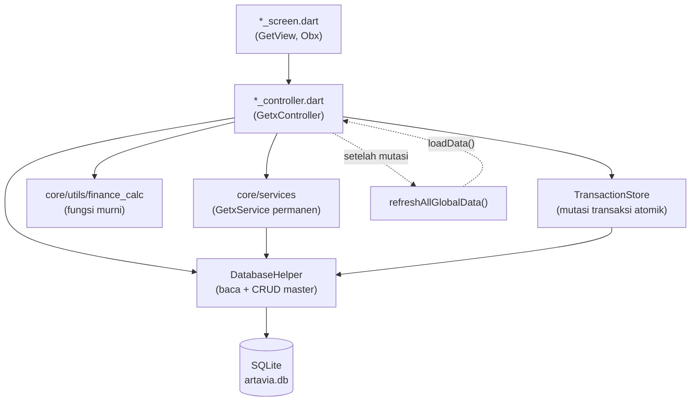
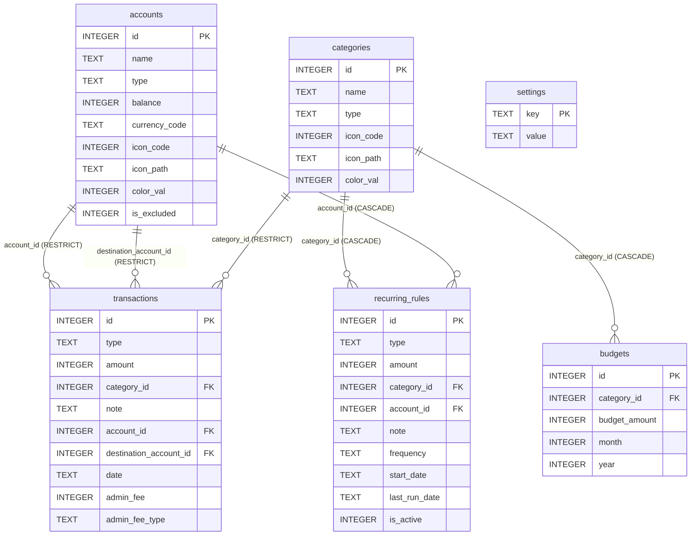
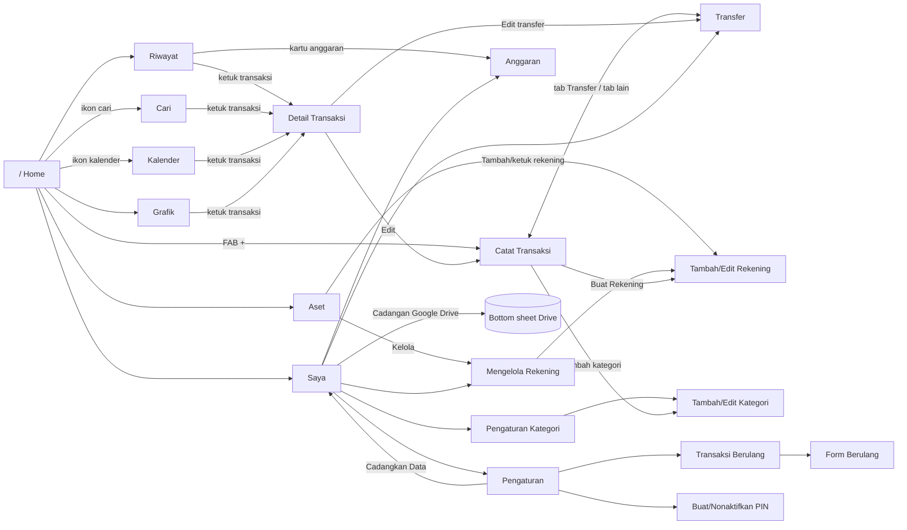

# Spesifikasi Aplikasi Artavia — Money Tracker

| Atribut | Nilai |
| --- | --- |
| Nama produk | **Artavia** |
| Jenis | Aplikasi mobile pencatat keuangan pribadi (money tracker / expense manager) |
| Platform | Android (utama), iOS (konfigurasi tersedia) |
| Versi aplikasi | `1.0.0+1` (`pubspec.yaml`) |
| Versi skema database | `11` |
| Bahasa UI | Bahasa Indonesia (locale `id_ID`) |
| Status | Pengembangan aktif |
| Dokumen ini disusun dari | Kode sumber `lib/`, `test/`, `pubspec.yaml`, konfigurasi Android/iOS, `specs/001-ui-polish-revamp/`, dan `.scutum/memory/constitution.md` per 27 Oktober 2026 |

> Dokumen ini menjelaskan **perilaku aplikasi sebagaimana diimplementasikan saat ini**. Bagian
> [15. Catatan Teknis, Keterbatasan & Risiko](#15-catatan-teknis-keterbatasan--risiko) mencatat
> hal-hal yang ditemukan saat penelusuran kode dan belum tentu sesuai harapan produk.

---

## Daftar Isi

1. [Ringkasan Produk](#1-ringkasan-produk)
2. [Ruang Lingkup](#2-ruang-lingkup)
3. [Teknologi & Dependensi](#3-teknologi--dependensi)
4. [Arsitektur Aplikasi](#4-arsitektur-aplikasi)
5. [Model Data & Database](#5-model-data--database)
6. [Aturan Bisnis Inti](#6-aturan-bisnis-inti)
7. [Navigasi & Peta Layar](#7-navigasi--peta-layar)
8. [Spesifikasi Fitur per Layar](#8-spesifikasi-fitur-per-layar)
9. [Layanan Global (Services)](#9-layanan-global-services)
10. [Sistem Desain & UI](#10-sistem-desain--ui)
11. [Onboarding (Coachmark)](#11-onboarding-coachmark)
12. [Keamanan & Privasi](#12-keamanan--privasi)
13. [Integrasi Platform & Izin](#13-integrasi-platform--izin)
14. [Kualitas, Pengujian & Konvensi](#14-kualitas-pengujian--konvensi)
15. [Catatan Teknis, Keterbatasan & Risiko](#15-catatan-teknis-keterbatasan--risiko)
16. [Glosarium](#16-glosarium)
17. [Lampiran](#17-lampiran)

---

## 1. Ringkasan Produk

### 1.1 Deskripsi
Artavia adalah aplikasi pencatat keuangan pribadi yang **local-first** dan **berfokus pada privasi**.
Semua data disimpan di perangkat (SQLite) tanpa akun, server, maupun pelacakan. Fitur cloud
satu-satunya adalah **cadangan/pemulihan ke Google Drive** yang hanya berjalan atas permintaan pengguna.

### 1.2 Tujuan Produk
- Mencatat pengeluaran, pemasukan, dan transfer antar-rekening dengan cepat (numpad khusus, kategori ikon).
- Memberi gambaran kondisi keuangan: ringkasan bulanan, distribusi kategori, tren, dan kekayaan bersih.
- Mengendalikan belanja lewat anggaran per kategori dan peringatan saat melewati batas.
- Mengotomatiskan transaksi rutin (gaji, sewa, langganan).
- Menjaga data tetap aman (PIN) dan portabel (CSV, Google Drive).

### 1.3 Pengguna Sasaran
Individu berbahasa Indonesia yang ingin mencatat keuangan harian secara offline, memiliki beberapa
"dompet" (tunai, bank, e-wallet, kartu kredit, dsb.), dan tidak ingin datanya dikirim ke server pihak ketiga.

### 1.4 Prinsip Produk (dari Constitution v1.0.0)
| # | Prinsip | Implikasi |
| --- | --- | --- |
| I | **Local-First & Privacy** | Semua data di SQLite lokal; tidak ada analitik/tracking; cloud bersifat opt-in. |
| II | **Feature-Based GetX Architecture** | Satu folder per fitur di `lib/page/<fitur>/`; logika di controller; named routes. |
| III | **Single Source of Visual Truth** | Semua warna dari `colors.dart`; toast & dialog lewat helper bersama. |
| IV | **Consistent Data Mutations** | Perubahan transaksi + saldo dalam satu DB transaction; `refreshAllGlobalData()` setelah mutasi. |
| V | **Honest, Simple UI** | Tidak ada tombol palsu; menu developer hanya di debug; copy Bahasa Indonesia. |

---

## 2. Ruang Lingkup

### 2.1 Fitur yang Tersedia
| Kode | Fitur | Ringkasan |
| --- | --- | --- |
| F-01 | Pencatatan Pengeluaran/Pemasukan | Numpad kalkulator (+/−), pilih kategori, rekening, tanggal, catatan. |
| F-02 | Transfer antar-rekening | Nominal dikirim vs diterima, selisih = biaya admin. |
| F-03 | Riwayat transaksi | Dikelompokkan per hari, ringkasan periode, sembunyikan saldo. |
| F-04 | Detail, edit, hapus transaksi | Dari daftar (geser) atau layar detail; saldo otomatis dikoreksi. |
| F-05 | Grafik/analisis | Mode Pekan/Bulan/Tahun, donut kategori, tren garis. |
| F-06 | Aset (kekayaan bersih) | Total aset, liabilitas, daftar rekening per tipe. |
| F-07 | Manajemen rekening | 9 tipe, 10 mata uang, ikon, warna, opsi "kecualikan dari total". |
| F-08 | Manajemen kategori | Pengeluaran/pemasukan, 11 grup ikon, 12 warna palet. |
| F-09 | Anggaran bulanan | Batas per kategori per periode, progress, peringatan lewat batas. |
| F-10 | Kalender | Ringkasan net harian dan daftar transaksi per tanggal. |
| F-11 | Pencarian | Cari catatan/kategori + filter jenis. |
| F-12 | Transaksi berulang | Harian/mingguan/bulanan, dibuat otomatis saat app dibuka. |
| F-13 | Pengaturan | Pengingat harian, awal bulan kustom, PIN, format angka, efek suara. |
| F-14 | Ekspor/Impor CSV | Format kontrak tetap, validasi per baris, impor atomik. |
| F-15 | Cadangan Google Drive | Backup/restore file database. |
| F-16 | Kunci PIN | PIN 4 digit, kunci saat buka & kembali dari latar belakang. |
| F-17 | Onboarding coachmark | Panduan membuat rekening pertama. |

### 2.2 Di Luar Lingkup (saat ini)
- Akun pengguna, login, sinkronisasi real-time multi-perangkat.
- Konversi kurs antar mata uang (lihat §15).
- Mode terang (aplikasi hanya tema gelap).
- Lampiran foto/struk, tag, sub-kategori, utang-piutang terpisah.
- Multi-bahasa selain Bahasa Indonesia.
- Widget home screen, biometrik (sidik jari/wajah).

---

## 3. Teknologi & Dependensi

### 3.1 Stack Inti
| Lapisan | Teknologi |
| --- | --- |
| Framework | Flutter, Dart SDK `^3.1.0`, Material 3 |
| State management, DI, routing | GetX (`get`) |
| Database lokal | SQLite via `sqflite` (`path` untuk path file) |
| Lokalisasi & format | `intl` dengan locale `id_ID` |
| Arsitektur | Feature-based (satu folder per fitur) |

### 3.2 Dependensi Runtime
| Paket | Versi | Kegunaan di Artavia |
| --- | --- | --- |
| `get` | any | Controller reaktif (`.obs`, `Obx`), `Bindings`, named routes, snackbar, dialog, bottom sheet |
| `intl` | any | Format mata uang, tanggal, nama hari/bulan Indonesia |
| `sqflite` | any | Database `artavia.db` |
| `path` | any | Menggabungkan path database |
| `fl_chart` | ^0.69.0 | Donut (`PieChart`) & garis tren (`LineChart`) di tab Grafik |
| `table_calendar` | any | Layar Kalender |
| `flutter_slidable` | ^4.0.3 | Aksi geser Edit/Hapus pada transaksi & anggaran |
| `tutorial_coach_mark` | ^1.3.3 | Onboarding sorotan (coachmark) |
| `google_sign_in` | ^7.2.0 | Autentikasi Google untuk Drive |
| `googleapis` | ^16.0.0 | Drive API v3 |
| `googleapis_auth` | ^2.3.3 | Pendukung autentikasi Google API |
| `http` | ^1.6.0 | Klien HTTP dengan header otorisasi |
| `path_provider` | ^2.1.6 | Direktori sementara untuk file CSV ekspor |
| `share_plus` | ^13.3.1 | Share sheet untuk file CSV |
| `file_picker` | ^13.2.0 | Memilih file CSV untuk impor |
| `flutter_local_notifications` | ^22.3.3 | Pengingat harian |
| `timezone` | ^0.11.2 | Penjadwalan notifikasi berbasis zona waktu |
| `flutter_timezone` | ^5.1.1 | Mendeteksi zona waktu perangkat |
| `audioplayers` | ^6.8.1 | Bunyi sukses setelah menyimpan transaksi |
| `cryptography` | ^2.9.0 | PBKDF2-HMAC-SHA256 untuk hash PIN |
| `flutter_svg` | ^2.3.0 | Terdaftar; tidak ditemukan pemakaian di `lib/` |
| `cupertino_icons` | ^1.0.8 | Ikon iOS (bawaan template) |

### 3.3 Dependensi Pengembangan
| Paket | Kegunaan |
| --- | --- |
| `flutter_test` | Unit test |
| `flutter_lints` | Aturan lint (`analysis_options.yaml` → `package:flutter_lints/flutter.yaml`) |
| `sqflite_common_ffi` | SQLite di lingkungan test desktop |
| `flutter_launcher_icons` | Ikon aplikasi dari `assets/logo/ARTAVIA_LOGO.png` (Android minSdk 21, iOS) |
| `flutter_native_splash` | Splash screen warna `#121212` + logo |

### 3.4 Aset
| Folder | Isi |
| --- | --- |
| `assets/belanja/`, `berpergian/`, `hiburan/`, `kehidupan/`, `kesehatan/`, `keuangan/`, `makanan/`, `olahraga/`, `pendidikan/`, `pribadi/`, `transportasi/` | Ikon PNG kategori/rekening (±117 ikon, didaftarkan di `AppIcons`) |
| `assets/sounds/success.wav` | Bunyi sukses |
| `assets/logo/ARTAVIA_LOGO.png` | Logo untuk launcher icon & splash |

Ikon PNG digambar dengan `color` tint (monokrom) sesuai warna kategori/rekening.

---

## 4. Arsitektur Aplikasi

### 4.1 Struktur Direktori
```text
lib/
├── main.dart                       # Entry point, inisialisasi service, tema global
├── core/
│   ├── database/
│   │   ├── database_helper.dart    # Singleton SQLite: skema, migrasi, CRUD baca
│   │   ├── transaction_store.dart  # Extension: semua mutasi transaksi + efek saldo (atomik)
│   │   └── dummy_data.dart         # Generator data contoh (debug)
│   ├── models/
│   │   ├── account_model.dart      # AccountModel
│   │   └── recurring_rule.dart     # RecurringRule + RecurringFrequency
│   ├── services/                   # GetxService permanen (lihat §9)
│   │   ├── settings_service.dart, period_service.dart, pin_lock_service.dart,
│   │   ├── recurring_service.dart, notification_service.dart, sound_service.dart,
│   │   ├── google_drive_service.dart, csv_service.dart
│   └── utils/
│       ├── currency_format.dart    # CurrencyService + CurrencyInputFormatter
│       ├── date_format.dart        # DateFormatter (relatif) + IdNames (nama hari/bulan)
│       ├── finance_calc.dart       # Fungsi murni: net worth, tren, filter, anggaran
│       └── data_refresh.dart       # refreshAllGlobalData()
├── model/
│   └── transaction_model.dart      # TransactionModel (baris transaksi + hasil JOIN)
├── page/                           # Satu folder per fitur: *_screen, *_controller, *_binding
│   ├── routes.dart                 # Konstanta route + daftar GetPage
│   ├── home/  chart/  report/  profile/
│   ├── add_transaction/  transfer/  transaction_detail/
│   ├── account_management/  category_management/  budget/
│   ├── calendar/  search/  recurring/  settings/  pin/
└── widgets/
    ├── commons/                    # common.dart (+ part colors.dart, strings.dart), CategoryIcon
    ├── components/                 # AppToast/AppDialog, BouncyButton, MenuGroup, TutorialCard, TypeSwitcher
    └── transaction/transaction_item.dart
```

### 4.2 Pola Lapisan


- **Screen**: hanya UI; turunan `GetView<Controller>`, reaktif lewat `Obx`.
- **Controller**: state `.obs`, validasi, pemanggilan DB, navigasi, toast.
- **Service**: state lintas layar (pengaturan, periode aktif, kunci PIN, dsb.), di-`Get.put(permanent: true)`.
- **DatabaseHelper**: singleton `DatabaseHelper.instance`; membuka DB sekali (lazy).
- **TransactionStore**: extension di atas `DatabaseHelper`; satu-satunya jalur penulisan tabel `transactions`.

### 4.3 Urutan Startup (`main()`)
1. `WidgetsFlutterBinding.ensureInitialized()`.
2. `initializeDateFormatting('id_ID')`.
3. `Get.put(GoogleDriveService)` → mulai inisialisasi Google Sign-In + *lightweight authentication*.
4. `await Get.putAsync(SettingsService().init())` → membuka DB (membuat/migrasi), memuat seluruh tabel `settings` ke memori, menerapkan format angka.
5. `Get.put(PeriodService)` → periode aktif = periode yang memuat hari ini.
6. `Get.put(SoundService)`, `Get.put(PinLockService)` (langsung terkunci jika PIN aktif).
7. `Get.put(RecurringService)` lalu **`await RecurringService.to.runDue()`** → membuat transaksi berulang yang jatuh tempo.
8. `await Get.putAsync(NotificationService().init())` → set zona waktu, inisialisasi plugin, jadwalkan ulang pengingat bila aktif.
9. Set status bar transparan & navigation bar `colorCard`.
10. `runApp(MyApp)` → `GetMaterialApp` dengan `initialRoute: '/'`, transisi `cupertino` 280 ms, tema `buildAppTheme()`, dan `builder` yang membungkus seluruh navigator dengan `LockOverlay`.

### 4.4 Dependency Injection
| Komponen | Cara registrasi | Umur |
| --- | --- | --- |
| Semua service | `Get.put` / `Get.putAsync`, `permanent: true` | Seumur aplikasi |
| `HomeController`, `ChartController`, `ReportController`, `ProfileController` | `HomeBinding` (`lazyPut`) | Selama route `/` hidup (selalu) |
| Controller fitur lain | `Binding` per route | Dibuat saat route dibuka, dihapus saat ditutup |
| `AccountManagementController` | Binding route `/account-management` & `/add-account`, atau `Get.put` dari `openEditor()` | Bergantung pemanggil |
| `CategoryManagementController` | Binding `/category-management` & `/add-category` (dipakai bersama) | Per route |
| `RecurringController` | Binding `/recurring` & `/recurring/form` (dipakai bersama) | Per route |

### 4.5 Sinkronisasi Data Antar-Layar
`refreshAllGlobalData()` (`core/utils/data_refresh.dart`) dipanggil setelah setiap mutasi
(transaksi, rekening, kategori, anggaran, reset, restore, impor, ganti format/awal bulan). Fungsi ini
memanggil ulang pemuat data pada controller yang **sedang terdaftar**:

| Controller | Method dipanggil |
| --- | --- |
| `HomeController` | `loadData()` |
| `ReportController` | `loadData()` |
| `ChartController` | `loadData()` |
| `CalendarController` | `loadMonth(focusedDay)` + `loadDayTransactions(selectedDay)` |
| `BudgetController` | `loadData()` |
| `ProfileController` | `loadStats()` |
| `SearchController` | `doSearch()` |

Selain itu, `HomeController`, `ChartController` (mode Bulan), dan `BudgetController` memakai
`ever(PeriodService.active, ...)` sehingga pergantian bulan di satu layar otomatis berlaku di layar lain.

---

## 5. Model Data & Database

### 5.1 Informasi Umum
- File: `artavia.db` di `getDatabasesPath()`.
- Versi skema: **11**. `PRAGMA foreign_keys = ON` diaktifkan di `onConfigure`.
- Semua nominal disimpan sebagai **INTEGER** (satuan mata uang utuh, tanpa desimal).
- Tanggal transaksi disimpan sebagai **TEXT ISO-8601 waktu lokal** (`DateTime.toIso8601String()`, tanpa zona).

### 5.2 Diagram Relasi


### 5.3 Definisi Tabel

#### `transactions`
| Kolom | Tipe | Null | Default | Keterangan |
| --- | --- | --- | --- | --- |
| `id` | INTEGER PK AUTOINCREMENT | – | – | |
| `type` | TEXT | NOT NULL | – | `pengeluaran` \| `pemasukan` \| `transfer` |
| `amount` | INTEGER | NOT NULL | – | Selalu positif. Untuk transfer = nominal **diterima** |
| `category_id` | INTEGER | ya | – | FK `categories` ON DELETE **RESTRICT**; `NULL` untuk transfer |
| `note` | TEXT | NOT NULL | – | Boleh string kosong |
| `account_id` | INTEGER | ya | – | FK `accounts` **RESTRICT**; rekening sumber |
| `destination_account_id` | INTEGER | ya | – | FK `accounts` **RESTRICT**; hanya transfer |
| `date` | TEXT | NOT NULL | – | ISO-8601 lokal |
| `admin_fee` | INTEGER | NOT NULL | 0 | Biaya admin transfer |
| `admin_fee_type` | TEXT | ya | – | `Pengirim` (dipakai saat ini) atau `Penerima` (didukung logika saldo) |

#### `accounts`
| Kolom | Tipe | Default | Keterangan |
| --- | --- | --- | --- |
| `id` | INTEGER PK | – | |
| `name` | TEXT NOT NULL | – | |
| `type` | TEXT NOT NULL | – | Salah satu dari 9 tipe (§8.9) atau `Lainnya` |
| `balance` | INTEGER NOT NULL | – | Saldo berjalan; negatif = liabilitas |
| `currency_code` | TEXT NOT NULL | `"IDR"` | Kode ISO; hanya label (lihat §15) |
| `icon_code` | INTEGER | – | Codepoint Material Icons |
| `icon_path` | TEXT | – | Path aset PNG; diprioritaskan di atas `icon_code` |
| `color_val` | INTEGER | – | ARGB32 |
| `is_excluded` | INTEGER NOT NULL | 0 | 1 = tidak dihitung dalam kekayaan bersih |

#### `categories`
| Kolom | Tipe | Keterangan |
| --- | --- | --- |
| `id` | INTEGER PK | |
| `name` | TEXT NOT NULL | |
| `type` | TEXT NOT NULL | `pengeluaran` \| `pemasukan` |
| `icon_code` | INTEGER | Codepoint Material Icons |
| `icon_path` | TEXT | Path aset PNG |
| `color_val` | INTEGER | ARGB32 |

#### `budgets`
| Kolom | Tipe | Keterangan |
| --- | --- | --- |
| `id` | INTEGER PK | |
| `category_id` | INTEGER | FK `categories` ON DELETE **CASCADE** |
| `budget_amount` | INTEGER NOT NULL | Batas per periode |
| `month` | INTEGER NOT NULL | Label bulan periode (1–12) |
| `year` | INTEGER NOT NULL | Label tahun periode |

Unik secara logika per (`category_id`, `month`, `year`) — dijamin oleh `upsertBudget()`, bukan constraint DB.

#### `recurring_rules`
| Kolom | Tipe | Default | Keterangan |
| --- | --- | --- | --- |
| `id` | INTEGER PK | – | |
| `type` | TEXT NOT NULL | – | `pengeluaran` \| `pemasukan` |
| `amount` | INTEGER NOT NULL | – | |
| `category_id` | INTEGER NOT NULL | – | FK **CASCADE** |
| `account_id` | INTEGER NOT NULL | – | FK **CASCADE** |
| `note` | TEXT NOT NULL | `''` | |
| `frequency` | TEXT NOT NULL | – | `daily` \| `weekly` \| `monthly` |
| `start_date` | TEXT NOT NULL | – | `yyyy-MM-dd` |
| `last_run_date` | TEXT | – | Tanggal kejadian terakhir yang sudah dibuat |
| `is_active` | INTEGER NOT NULL | 1 | 0 = dijeda |

#### `settings`
Key–value string. Daftar key resmi:

| Key | Nilai | Default | Dipakai oleh |
| --- | --- | --- | --- |
| `daily_reminder` | `true`/`false` | `false` | NotificationService |
| `reminder_time` | `HH:mm` | `20:00` | NotificationService |
| `month_start_day` | `1`..`28` | `1` | PeriodService |
| `app_lock` | `true`/`false` | `false` | PinLockService |
| `pin_salt` | base64 (16 byte) | – | PinLockService |
| `pin_hash` | base64 PBKDF2-SHA256 | – | PinLockService |
| `number_format` | `dot`/`comma` | `dot` | CurrencyService |
| `sound_effect` | `true`/`false` | `false` | SoundService |

### 5.4 Data Awal (Seed) Kategori
Dibuat saat database pertama kali dibuat (`onCreate`):

| # | Nama | Jenis | Ikon | Warna |
| --- | --- | --- | --- | --- |
| 1 | Makanan | pengeluaran | `makanan/bowl.png` | `#E59A6B` |
| 2 | Minuman | pengeluaran | `makanan/soft-drink.png` | `#4FB6B0` |
| 3 | Belanja | pengeluaran | `belanja/shopping-bag.png` | `#D98AA8` |
| 4 | Transportasi | pengeluaran | `transportasi/car.png` | `#5FA8D3` |
| 5 | Kesehatan | pengeluaran | `kesehatan/health-care.png` | `#E07A7A` |
| 6 | Hiburan | pengeluaran | `hiburan/cinema.png` | `#C987C9` |
| 7 | Pendidikan | pengeluaran | `pendidikan/education.png` | `#7AA2F7` |
| 8 | Olahraga | pengeluaran | `olahraga/sport.png` | `#A3BE6C` |
| 9 | Liburan | pengeluaran | `berpergian/travel.png` | `#E0B25C` |
| 10 | Pribadi | pengeluaran | `pribadi/briefcase.png` | `#8D94A3` |
| 11 | Tagihan | pengeluaran | `pribadi/wifi.png` | `#9D8CE6` |
| 12 | Gaji | pemasukan | `keuangan/uang.png` | `#5FBF8F` |
| 13 | Bonus | pemasukan | `keuangan/coin.png` | `#A3BE6C` |
| 14 | Investasi | pemasukan | `keuangan/stock.png` | `#4FB6B0` |
| 15 | Bisnis | pemasukan | `pribadi/meeting.png` | `#7AA2F7` |
| 16 | Tabungan | pemasukan | `keuangan/nabung.png` | `#E0B25C` |

Tidak ada rekening bawaan — pengguna wajib membuat rekening pertama (dipandu coachmark).
Jika konstanta `useDummyData = true` (default `false`), `DummyDataGenerator` juga menambah 3 rekening,
50 transaksi acak (±30 hari terakhir), dan 3 anggaran bulan berjalan.

### 5.5 Riwayat Migrasi (`onUpgrade`)
| Dari versi < | Perubahan |
| --- | --- |
| 2 | Buat tabel `categories` + 6 kategori dasar |
| 3 | `accounts.type` (default `Kas Pribadi`) |
| 4 | Tabel `budgets` (versi awal, kolom `category` TEXT) dan `settings` |
| 5 | `accounts.icon_code`, `color_val`, `is_excluded` |
| 7 | `transactions.category_id`, `account_id`, `destination_account_id` |
| 8 | `accounts.currency_code` |
| 9 | `categories.icon_path`, `accounts.icon_path` |
| 10 | `transactions.admin_fee`, `admin_fee_type` |
| 11 | Tabel `recurring_rules` |

Setiap `ALTER TABLE` dibungkus `try/catch` agar idempoten.

### 5.6 Model Dart
| Kelas | File | Catatan |
| --- | --- | --- |
| `TransactionModel` | `lib/model/transaction_model.dart` | Mutable; memuat hasil JOIN (`categoryName`, `accountName`, `destinationAccountName`, ikon & warna kategori). `fromDbRow` menghasilkan `amount` **positif untuk pemasukan, negatif untuk lainnya**. |
| `AccountModel` | `lib/core/models/account_model.dart` | Immutable + `copyWith`; default ikon `0xe4fc`, warna `0xFFE0B25C`. |
| `RecurringRule` | `lib/core/models/recurring_rule.dart` | Immutable; `fromRow`/`toRow`; `dateOnly()` → `yyyy-MM-dd`. |
| `RecurringFrequency` | idem | `daily`→Harian, `weekly`→Mingguan, `monthly`→Bulanan (default saat parse gagal). |
| `Period` | `lib/core/services/period_service.dart` | `year`, `month`, `start`, `end`, `label` (mis. "Okt 2026"). |
| `NetWorth`, `TrendPoint`, `BudgetSummary`, `CategorySlice` | `finance_calc.dart`, `chart_controller.dart` | Struktur hasil kalkulasi. |

### 5.7 Query Baca Utama (`DatabaseHelper`)
| Method | Perilaku |
| --- | --- |
| `readAllTransactions()` | Semua transaksi + JOIN kategori/rekening, urut `date DESC` |
| `readTransactionsByRange(start, end)` | `start <= date < end`, urut terbaru |
| `readTransactionsByMonth(y, m)` | Bulan kalender (dipakai Kalender) |
| `searchTransactions(q)` | `note LIKE %q% OR category.name LIKE %q%` |
| `readAllAccounts()` | Urut `type ASC, name ASC` |
| `readBudgetsByMonth(y, m)` | INNER JOIN kategori |
| `readRecurringRules()` | JOIN kategori/rekening, urut `is_active DESC, start_date ASC` |
| `resetDatabase()` | Tutup koneksi, hapus file, buat ulang (seed kategori lagi) |

---

## 6. Aturan Bisnis Inti

### 6.1 Efek Transaksi terhadap Saldo Rekening
Semua mutasi transaksi lewat `TransactionStore` dan berjalan dalam **satu DB transaction** bersama
pembaruan saldo. Efek selalu dihitung dari baris yang tersimpan, sehingga hapus/edit tidak memerlukan
nilai lama dari pemanggil.

| Jenis | Rekening sumber (`account_id`) | Rekening tujuan |
| --- | --- | --- |
| `pengeluaran` | `balance −= amount` | – |
| `pemasukan` | `balance += amount` | – |
| `transfer`, fee `Pengirim` | `balance −= amount + admin_fee` | `balance += amount` |
| `transfer`, fee `Penerima` | `balance −= amount` | `balance += amount − admin_fee` |

- **Tambah**: insert baris lalu terapkan efek (`sign = +1`).
- **Hapus**: baca baris, balik efek (`sign = −1`), hapus baris.
- **Edit** (`replaceTransaction`): hapus baris lama + balik efeknya, lalu insert baris baru + efeknya —
  semuanya atomik. Bekerja meski rekening lama sudah tidak ada. ID transaksi **berubah** setelah edit.
- Rekening dengan `id = NULL` atau `delta = 0` dilewati.

### 6.2 Transfer & Biaya Admin
- Pengguna memasukkan **Dipotong** (nominal keluar dari pengirim) dan **Diterima** (nominal masuk ke penerima).
- Disimpan: `amount = Diterima`, `admin_fee = Dipotong − Diterima`, `admin_fee_type = 'Pengirim'`.
- Selama mode **sinkron** aktif, mengetik di Dipotong otomatis menyalin ke Diterima (fee 0). Mengetuk
  salah satu kolom mematikan sinkronisasi.
- Validasi: kedua rekening terpilih; rekening asal ≠ tujuan; kedua nominal > 0; Dipotong ≥ Diterima.
- Butuh minimal **2 rekening**.

### 6.3 Kekayaan Bersih (Net Worth)
Satu aturan dipakai di tab Aset dan tab Saya (`computeNetWorth`):
- Rekening dengan `is_excluded = 1` diabaikan.
- Saldo ≥ 0 → **Total Aset**; saldo < 0 → **Total Liabilitas** (nilai absolut).
- **Kekayaan Bersih = Aset − Liabilitas**.
- Subtotal per grup tipe di tab Aset memakai fungsi yang sama.

### 6.4 Periode (Awal Bulan Kustom)
- Pengaturan `month_start_day` ∈ 1..28 (default 1).
- Periode diberi label bulan **tempat periode berakhir**. Dengan start day `d > 1`:
  periode "Okt" = `d Sep` s.d. `(d−1) Okt` (contoh d = 25: 25 Sep – 24 Okt).
- Interval selalu setengah-terbuka: `start <= date < end`.
- `Period.containing(date)`: jika `date.day >= d` maka masuk periode bulan berikutnya.
- **Periode aktif dibagi** oleh Riwayat, Grafik (mode Bulan), dan Anggaran. Kalender tetap memakai bulan kalender.
- Mengubah awal bulan me-reset periode aktif ke periode hari ini.

### 6.5 Anggaran
- Anggaran dibuat per kategori **pengeluaran** per periode (`month`, `year` dari label periode).
- Terpakai = jumlah `pengeluaran` kategori tersebut di rentang periode.
- `BudgetSummary`: total batas, total terpakai, jumlah kategori melewati batas (`used > limit`), rasio.
- Warna progress di Riwayat: merah (`colorExpense`) jika ada kategori lewat batas; kuning
  (`colorWarning`) jika rasio ≥ 80 %; selain itu biru aksen.
- Setelah menyimpan pengeluaran, jika kategori itu memiliki anggaran dan total terpakai > batas,
  muncul toast peringatan **"Melewati anggaran"** berisi `Kategori: Rp terpakai dari Rp batas`
  (menggantikan toast sukses).
- Anggaran tidak otomatis disalin ke bulan berikutnya.

### 6.6 Transaksi Berulang
- Kejadian ke-`n` dihitung dari `start_date`:
  - **Harian**: `start + n hari`; **Mingguan**: `start + 7n hari`;
  - **Bulanan**: tanggal sama tiap bulan, **di-clamp** ke hari terakhir bulan pendek (31 → 30/28/29),
    lalu kembali ke 31 di bulan panjang.
- `dueDates(rule, today)`: semua kejadian setelah `last_run_date` dan ≤ hari ini, maksimal
  **400 per aturan per eksekusi** (`maxOccurrencesPerRun`).
- `runDue()` berjalan: saat startup, setelah menyimpan aturan, dan saat aturan diaktifkan kembali.
- Kejadian dibuat sebagai transaksi biasa pukul **08:00** di tanggal tersebut, lalu `last_run_date`
  diperbarui **dalam DB transaction yang sama** → tidak pernah dobel.
- Edit aturan mempertahankan `last_run_date`, kecuali jadwal (frekuensi/tanggal mulai) berubah **dan**
  tanggal mulai baru di masa depan → `last_run_date` di-reset.
- Menghapus aturan **tidak** menghapus transaksi yang sudah tercatat.
- Aturan ikut terhapus (CASCADE) bila kategori atau rekeningnya dihapus.

### 6.7 Penghapusan Master Data
| Entitas | Aturan |
| --- | --- |
| Rekening | Ditolak jika dipakai transaksi (FK RESTRICT) → toast "Tidak Dapat Dihapus". Transaksi berulang terkait ikut terhapus. |
| Kategori | Ditolak jika dipakai transaksi. Anggaran & transaksi berulang terkait ikut terhapus. |
| Anggaran | Dihapus langsung setelah konfirmasi. |
| Transaksi | Dihapus setelah konfirmasi; saldo dikoreksi. |

### 6.8 Format Angka & Mata Uang
- `CurrencyService.format()` → `Rp 1.234.567` (titik) atau `Rp 1,234,567` (koma), tanpa desimal.
- `formatWithoutSymbol()` → tanpa "Rp".
- `compact()` → `Rp 5 rb`, `Rp 1 jt` (selalu locale `id_ID`).
- `CurrencyInputFormatter` memformat ribuan saat mengetik sesuai separator aktif.
- Simbol "Rp" dipakai untuk semua rekening, apa pun `currency_code`-nya.

### 6.9 Tren Pengeluaran
`buildTrend()` hanya menjumlah `pengeluaran`:
| Mode | Rentang | Bucket | Label sumbu |
| --- | --- | --- | --- |
| Pekan | Senin 00:00 + 7 hari | 7 hari | Sen, Sel, Rab, Kam, Jum, Sab, Min |
| Bulan | Periode aktif | 1 per hari periode | Tanggal |
| Tahun | 1 Jan – 1 Jan berikutnya | 12 bulan | Jan … Des |

Rata-rata = total pengeluaran ÷ jumlah bucket yang memiliki pengeluaran ("per hari/bulan aktif").

---

## 7. Navigasi & Peta Layar

### 7.1 Daftar Route
| Konstanta | Path | Layar | Binding |
| --- | --- | --- | --- |
| `homeRoute` | `/` | `HomeScreen` (4 tab) | `HomeBinding` |
| `addTransactionRoute` | `/add-transaction` | `AddTransactionScreen` | `AddTransactionBinding` |
| `transferRoute` | `/transfer` | `TransferScreen` | `TransferBinding` |
| `transactionDetailRoute` | `/transaction-detail` | `TransactionDetailScreen` | – |
| `accountManagementRoute` | `/account-management` | `AccountManagementScreen` | `AccountManagementBinding` |
| `addAccountRoute` | `/add-account` | `AddAccountScreen` | `AccountManagementBinding` |
| `categoryManagementRoute` | `/category-management` | `CategoryManagementScreen` | `CategoryManagementBinding` |
| `addCategoryRoute` | `/add-category` | `AddCategoryScreen` | `CategoryManagementBinding` |
| `budgetRoute` | `/budget` | `BudgetScreen` | `BudgetBinding` |
| `calendarRoute` | `/calendar` | `CalendarScreen` | `CalendarBinding` |
| `searchRoute` | `/search` | `SearchScreen` | `SearchBinding` |
| `settingsRoute` | `/settings` | `SettingsScreen` | `SettingsBinding` |
| `pinRoute` | `/pin` | `PinScreen` | `PinBinding` |
| `recurringRoute` | `/recurring` | `RecurringScreen` | `RecurringBinding` |
| `recurringFormRoute` | `/recurring/form` | `RecurringFormScreen` | `RecurringBinding` |

### 7.2 Peta Navigasi


### 7.3 Argumen Antar-Layar
`transactionArgs(tx)` menyusun map yang dipakai bersama oleh Detail, Edit Transaksi, dan Edit Transfer:
`id, type, amount (absolut), category, note, account, account_id, destination_account,
destination_account_id, admin_fee, admin_fee_type, date, icon_code, icon_path, color_val`.
Mode edit ditandai `isEdit: true`. `openTransactionEditor()` memilih `/transfer` bila `type == 'transfer'`,
selain itu `/add-transaction`. Layar Catat Transaksi juga menerima `initialTab`.

---

## 8. Spesifikasi Fitur per Layar

### 8.1 Home (Kerangka Utama)
- **AppBar**: judul "Artavia"; aksi **Cari** (→ `/search`) dan **Kalender** (→ `/calendar`).
- **Body**: `IndexedStack` 4 tab (state tiap tab dipertahankan).
- **Bottom navigation** (`BottomAppBar` dengan notch): Riwayat · Grafik · [ruang FAB] · Aset · Saya.
  Ikon aktif berwarna aksen dan bergaya *filled*.
- **FAB** bulat (56 px, aksen) di tengah-dock → `/add-transaction`. Memakai `BouncyButton` (animasi tekan).
- Setelah frame pertama: jika belum ada rekening, tampilkan coachmark (§11).

### 8.2 Tab Riwayat (`HistoryView`)
**Tujuan**: melihat transaksi pada periode aktif.

| Elemen | Perilaku |
| --- | --- |
| Kartu Ringkasan | Label periode (mis. "Okt 2026") + chevron → bottom sheet pemilih bulan. Tiga angka: **Pengeluaran** (merah), **Pemasukan** (hijau), **Saldo** (= pemasukan − pengeluaran periode). Tombol mata menyembunyikan angka menjadi `••••••` (tidak dipersist). |
| Pemilih periode | Bottom sheet: navigasi tahun ‹ › dan grid 4×3 nama bulan Indonesia. Bulan aktif disorot. Memilih bulan mengubah periode aktif global. |
| Kartu Anggaran | Tampil hanya bila total anggaran periode > 0. Menampilkan `terpakai / total`, progress bar berwarna (§6.5), dan teks "N kategori melewati batas". Ketuk → `/budget`. |
| Grup per hari | Header `EEEE, d MMM` (mis. "Senin, 5 Okt") + subtotal `+pemasukan` / `-pengeluaran` hari itu. Item dalam kartu dengan pemisah. |
| Item transaksi | Lihat §10.4 `TransactionItem`. |
| Pull-to-refresh | Memuat ulang data. |
| Loading | Spinner bila sedang memuat dan daftar kosong. |
| Kosong | Ikon + "Belum ada transaksi pada periode ini" / "Ketuk + untuk mulai mencatat". |

Transfer tidak dihitung dalam Pengeluaran/Pemasukan/Saldo periode.

### 8.3 Tab Grafik (`ChartScreen`)
**Tujuan**: satu-satunya layar analisis.

| Elemen | Perilaku |
| --- | --- |
| Pemilih mode | Chip **Pekan / Bulan / Tahun** (default Bulan). |
| Navigasi periode | ‹ label › — Pekan: "5 Okt – 11 Okt"; Bulan: label periode aktif (mengubah periode global); Tahun: "2026". |
| Kartu Ringkasan | Pengeluaran, Pemasukan, Saldo pada rentang terpilih. |
| Kosong | "Belum ada data pada periode ini" / "Tambahkan transaksi untuk melihat analisis". |
| Pengeluaran per Kategori | Donut `PieChart` dengan teks "Total" di tengah. Maksimal **5 irisan**: 4 kategori terbesar + **"Lain-lain"** (abu-abu) bila kategori > 5. Daftar irisan: ikon, nama, persentase (1 desimal), nominal, progress bar. Jika tidak ada pengeluaran: "Belum ada pengeluaran pada periode ini". |
| Detail irisan | Ketuk irisan → bottom sheet (maks 70 % tinggi layar): nama kategori, "N transaksi", daftar `TransactionItem` dengan tanggal; tiap item bisa dibuka ke Detail. |
| Tren Pengeluaran | `LineChart` sesuai §6.9, subjudul "Rata-rata X per hari/bulan aktif", tooltip label + nominal. |

Warna irisan memakai warna kategori; fallback ke `paletteColorAt(i)` bila kosong.

### 8.4 Tab Aset (`ReportScreen`)
| Elemen | Perilaku |
| --- | --- |
| Kartu Kekayaan Bersih | Nilai utama + **Total Aset** (hijau) dan **Total Liabilitas** (merah). |
| Baris aksi | **Tambah Rekening** (form kosong) dan **Kelola** (→ `/account-management`). |
| Daftar rekening | Dikelompokkan per tipe (judul huruf kapital + subtotal grup). Tile: ikon berwarna, nama, saldo; rekening dikecualikan menampilkan "Tidak dihitung dalam total". Ketuk → form edit rekening. |
| Kosong | "Belum ada rekening" / "Tambahkan rekening untuk mulai mencatat". |

### 8.5 Tab Saya (`ProfileScreen`)
| Elemen | Perilaku |
| --- | --- |
| Kartu ringkasan | Avatar, nama "Pengguna Artavia" (statis), **Kekayaan Bersih** (merah bila negatif), "N rekening · M kategori". |
| Grup **Keuangan** | Rekening → `/account-management`; Anggaran → `/budget`; Transfer Saldo → `/transfer`; Kategori → `/category-management`. |
| Grup **Data & Pengaturan** | **Cadangan Google Drive** (status "Terhubung"/"Belum") → bottom sheet aksi; **Pengaturan** → `/settings`. |
| Grup **Developer** | Hanya `kDebugMode`: "Generate Dummy Data" (dengan konfirmasi). |
| Footer | "Artavia · Versi 1.0.0". |
| Pull-to-refresh | Memuat ulang statistik. |

**Bottom sheet Google Drive**
- Belum terhubung: **Hubungkan Google Drive**.
- Terhubung: **Backup sekarang** · **Restore dari Drive** (konfirmasi "Data lokal akan ditimpa…") · **Putuskan koneksi** (merah).
- Backup/restore menampilkan dialog progres yang memblokir, lalu toast hasil.
- Setelah restore: `SettingsService.reload()`, periode di-reset, semua data di-refresh.

### 8.6 Catat / Edit Transaksi (`AddTransactionScreen`)
**Tujuan**: mencatat pengeluaran atau pemasukan.

**Tata letak (atas → bawah)**
1. AppBar: tombol **Tutup** (×), judul "Catat Transaksi" / "Edit Transaksi".
2. **Type switcher** 3 segmen: Pengeluaran · Pemasukan · Transfer (disembunyikan saat edit).
   Memilih Transfer mengganti route ke `/transfer`.
3. **Grid kategori** sesuai jenis (ikon dalam lingkaran + nama), sel terakhir **Tambah** → `/add-category`
   lalu memuat ulang kategori dengan mempertahankan pilihan. Bila kosong: "Belum ada kategori" + tombol Tambah Kategori.
4. Setelah kategori dipilih, muncul panel input:
   - **Pemilih rekening** (nama + "Saldo: Rp …") → bottom sheet "Pilih Rekening".
   - **Tampilan nominal** besar (merah untuk pengeluaran, hijau untuk pemasukan). Operasi tertunda
     ditampilkan di kiri (mis. "50.000 +"). Ketuk tampilan untuk menampilkan/menyembunyikan numpad.
   - **Catatan**: field satu baris "Tambahkan catatan..." + chip riwayat catatan (maks 10).
   - **Nominal cepat**: chip `+Rp 5 rb`, `+Rp 10 rb`, `+Rp 20 rb`, `+Rp 50 rb`, `+Rp 100 rb`, `+Rp 500 rb` (menambah ke nominal).
   - **Numpad**:

     | | | | |
     | --- | --- | --- | --- |
     | 7 | 8 | 9 | 📅 Tanggal ("Hari Ini"/"Kemarin"/"Besok"/tanggal) |
     | 4 | 5 | 6 | **+** |
     | 1 | 2 | 3 | **−** |
     | 0 | 000 | ⌫ | ✔ Simpan (aksen) |

**Aturan numpad**
- Maksimal **12 digit**; melebihi → toast "Batas Maksimal".
- `+`/`−` menyimpan operand dan mengosongkan tampilan; ✔ menyelesaikan operasi lalu menyimpan.
  Hasil pengurangan diambil **nilai absolut**.
- ⌫ menghapus satu digit (minimal "0").
- Tanggal dipilih dengan date picker (2000–2100); **jam saat ini** dipertahankan agar urutan dalam hari tetap alami.

**Validasi simpan** (urutan): rekening ada → "Buat rekening terlebih dahulu"; nominal > 0 → "Masukkan
nominal yang valid"; kategori dipilih → "Pilih kategori terlebih dahulu".

**Setelah simpan**: refresh global, bunyi sukses (bila aktif), cek anggaran (§6.5).
Tambah → kembali satu layar; Edit → kembali ke Home. Toast: "Tersimpan — Pengeluaran berhasil dicatat"
atau "Diperbarui — … berhasil diperbarui". Gagal → "Transaksi tidak dapat disimpan".

**Tanpa rekening**: form diganti layar "Buat rekening terlebih dahulu" + tombol **Buat Rekening**
(→ form rekening, lalu memuat ulang rekening).

**Mode edit**: data terisi dari argumen, jenis tidak bisa diubah, numpad langsung tampil.

### 8.7 Transfer (`TransferScreen`)
- AppBar: Tutup, judul "Catat Transaksi" / "Edit Transfer".
- Type switcher dengan "Transfer" terpilih; memilih jenis lain → `/add-transaction` dengan `initialTab`.
- Kartu **Dari** dan **Ke**: nama rekening + saldo, ketuk → bottom sheet pilih rekening.
- Dua kolom nominal: **Dipotong** (pengirim) dan **Diterima** (penerima); kolom aktif disorot (§6.2).
- Field "Pesan (opsional)" + chip riwayat.
- Numpad sama dengan Catat Transaksi: 7 8 9 📅 / 4 5 6 + / 1 2 3 − / 0 000 ⌫ ✔. Tombol `+`/`−` **tidak berfungsi** pada transfer. (Controller juga mendukung kunci `C` untuk mereset kedua nominal, tetapi tombolnya tidak ditampilkan.)
- Rekening < 2: layar "Rekening Belum Cukup — Anda butuh minimal 2 rekening untuk melakukan transfer." + tombol **Kelola Rekening**.
- Default: rekening pertama sebagai asal, kedua sebagai tujuan.
- Toast: "Berhasil — Transfer berhasil disimpan" / "Diperbarui — Transfer berhasil diperbarui".

### 8.8 Detail Transaksi (`TransactionDetailScreen`)
- AppBar "Detail Transaksi" + aksi **Edit** (membuka form sesuai jenis).
- Kartu atas: ikon kategori (atau ikon transfer), nama kategori/"Transfer", nominal besar dengan
  prefiks `-` (pengeluaran) / `+` (pemasukan) / tanpa prefiks (transfer).
- Baris info: **Rekening** atau **Dari**/**Ke**; **Biaya admin** (transfer, bila > 0);
  **Tanggal** format `EEEE, d MMMM yyyy · HH:mm`; **Catatan** (bila ada).
- Tombol **Hapus Transaksi** (outline merah) → konfirmasi → kembali.
- Layar bersifat statis berdasarkan argumen (tidak memuat ulang dari DB).

### 8.9 Mengelola Rekening & Form Rekening
**Daftar (`/account-management`)**: judul "Mengelola Rekening"; rekening dikelompokkan per tipe; tile
menampilkan ikon, nama, badge **Dikecualikan**, kode mata uang, saldo, tombol **Edit** dan **Hapus**.
FAB "Tambahkan". Kosong: "Belum ada rekening / Ketuk + untuk menambah rekening baru".

**Form (`/add-account`)** — judul "Tambah Rekening"/"Edit Rekening", tombol Simpan di AppBar dan bawah ("Simpan Rekening"):

| Bagian | Isi |
| --- | --- |
| Kartu pratinjau | Pratinjau langsung ikon, warna, nama, tipe, saldo |
| Tipe Rekening | Grid 9 tipe (memilih tipe mengatur ikon & warna default) |
| Nama & Saldo | Nama ("cth: BCA, GoPay, Dompet") dan **Saldo Awal** (prefiks kode mata uang, boleh negatif) |
| Mata Uang | Chip 10 mata uang |
| Ikon Rekening | Ikon default tipe + 8 ikon grup Keuangan |
| Warna Ikon | 12 warna palet |
| Kecualikan dari Total | Switch — "Saldo tidak dihitung dalam kekayaan bersih" |

**Tipe rekening**
| Tipe | Ikon Material | Warna default |
| --- | --- | --- |
| Kas Tunai | `payments` | `#E0B25C` |
| Bank | `account_balance` | `#5FA8D3` |
| Kartu Kredit | `credit_card` | `#E07A7A` |
| Dompet Digital | `phone_android` | `#5FBF8F` |
| Tabungan | `savings` | `#4FB6B0` |
| Investasi | `trending_up` | `#9D8CE6` |
| Pinjaman | `account_balance_wallet` | `#E59A6B` |
| Investasi Aset | `real_estate_agent` | `#8D94A3` |
| Lainnya | `more_horiz` | `#8D94A3` |

**Mata uang**: IDR (Rp), USD ($), EUR (€), SGD (S$), MYR (RM), GBP (£), JPY (¥), AUD (A$), CNY (¥), SAR (﷼).

**Aturan**: nama wajib ("Nama rekening tidak boleh kosong"). Mengedit **saldo** menimpa kolom `balance`
secara langsung (tidak membuat transaksi penyesuaian). `openEditor([account])` dapat dipanggil dari
mana saja (Aset, Catat Transaksi) dan selalu mereset/mengisi form dengan benar.

### 8.10 Kategori
**Daftar (`/category-management`)**: judul "Pengaturan Kategori"; tab **Pengeluaran / Pemasukan**;
tile ikon + nama + tombol Edit & Hapus; FAB "Tambah Kategori" (jenis mengikuti tab aktif).

**Form (`/add-category`)**: judul "Tambah Kategori"/"Edit Kategori", tombol Simpan; pilih jenis
(Pengeluaran/Pemasukan), field "Nama Kategori", **Pilih Warna** (12 palet), **Pilih Ikon** dari 11 grup:
Keuangan, Makanan, Belanja, Transportasi, Hiburan, Kesehatan, Pendidikan, Olahraga, Berpergian,
Kehidupan, Pribadi; pratinjau kategori. Nama wajib.

### 8.11 Anggaran Bulanan (`/budget`)
| Elemen | Perilaku |
| --- | --- |
| Navigasi bulan | ‹ label periode › (mengubah periode global) |
| Kartu total | **Total Anggaran** (atau "Belum ada anggaran"), **Terpakai**, **Sisa** |
| Daftar | Judul "Anggaran Kategori" + tombol **Tambah**. Item: ikon, kategori, `Rp terpakai / Rp batas`, progress, label "Melewati batas" bila lewat. Geser → **Edit** / **Hapus**. |
| Dialog Tambah | Dropdown kategori pengeluaran + "Batas per bulan" (Rp, terformat). Validasi: kategori dipilih, nominal > 0. |
| Dialog Edit | Judul "Anggaran {kategori}", ubah nominal. |
| Simpan | `upsertBudget` (kategori yang sama di periode yang sama ditimpa). Toast "Anggaran disimpan". |
| Kosong | "Belum ada anggaran bulan ini" / "Ketuk \"Tambah\" untuk membuat anggaran kategori". |

### 8.12 Kalender (`/calendar`)
- `TableCalendar` format bulan, rentang 2020–2030, tombol format disembunyikan.
- Marker per tanggal: **net** harian (pemasukan − pengeluaran) dalam format ringkas `id_ID`
  dengan prefiks `+`/`-`, berwarna sesuai tanda.
- Memilih tanggal → panel: tanggal (`dd MMM`), total pemasukan & pengeluaran hari itu, daftar transaksi.
  Kosong: "Tidak ada transaksi pada {tanggal}".
- Mengganti halaman bulan memuat data bulan tersebut. Selalu memakai **bulan kalender**.

### 8.13 Cari (`/search`)
- Field pencarian di AppBar "Cari catatan atau kategori…" + tombol hapus.
- Chip filter: **Semua · Pengeluaran · Pemasukan · Transfer**.
- Pencarian *debounce* **250 ms**; filter langsung memicu pencarian.
- Query kosong + filter Semua → "Ketik untuk mencari transaksi".
- Hasil: "N transaksi ditemukan" + daftar `TransactionItem`.
- Tidak ada hasil: "Tidak ada hasil untuk \"q\"" atau "Tidak ada transaksi {filter}".

### 8.14 Transaksi Berulang (`/recurring`, `/recurring/form`)
**Daftar**: FAB "Tambah"; tile berisi ikon kategori, nama/catatan, `Frekuensi · Rekening · berikutnya
5 Okt 2026` (atau "· dijeda"), nominal `±Rp`, dan switch aktif/jeda. Ketuk → edit; **tekan lama → hapus**
(konfirmasi "Transaksi yang sudah tercatat tidak ikut terhapus."). Kosong: "Belum ada transaksi berulang —
Gaji, sewa, atau langganan bisa dicatat otomatis setiap periode."

**Form** ("Tambah Berulang"/"Edit Berulang"):
| Field | Keterangan |
| --- | --- |
| Jenis | Segmented Pengeluaran / Pemasukan (mengganti jenis mereset kategori) |
| Nominal | Rp, wajib > 0 |
| Kategori | Chip kategori sesuai jenis, wajib |
| Rekening | Dropdown, default rekening pertama |
| Frekuensi | Harian / Mingguan / Bulanan (default Bulanan) |
| Mulai tanggal | Date picker |
| Catatan (opsional) | |
| Info | "Transaksi jatuh tempo dicatat otomatis saat aplikasi dibuka." |

Simpan → simpan aturan, jalankan `runDue()`, toast "N transaksi jatuh tempo dicatat" atau
"Transaksi berulang disimpan". Tanpa rekening, form tidak dibuka ("Belum ada rekening").

### 8.15 Pengaturan (`/settings`)
Seluruh item melakukan aksi nyata. Layar dikunci (`AbsorbPointer`) + spinner saat proses berjalan.

| Grup | Item | Perilaku |
| --- | --- | --- |
| **Pencatatan** | Transaksi Berulang | → `/recurring` |
| | Mulai Bulan Pada ("Tanggal N") | Bottom sheet chip 1–28 → simpan, reset periode, refresh |
| | Pengingat Harian (switch) | ON: minta izin notifikasi; ditolak → "Izin ditolak"; diizinkan → jadwal harian, toast "Kami akan mengingatkan setiap HH:mm". OFF: batalkan |
| | Jam Pengingat (hanya bila aktif) | Time picker → jadwal ulang |
| **Keamanan & Data** | Kunci Aplikasi (PIN) (switch) | ON → `/pin` mode setup; OFF → `/pin` mode disable (harus memasukkan PIN). Toast "PIN aktif"/"PIN nonaktif" |
| | Cadangkan Data ("Google Drive") | Kembali ke Home dan buka tab Saya |
| | Ekspor CSV | §9.8; bila 0 transaksi → "Belum ada transaksi untuk diekspor" |
| | Impor CSV | Pilih file → validasi → dialog konfirmasi "Impor N transaksi?" (menampilkan hingga 3 baris yang dilewati) → impor → "N transaksi berhasil diimpor" |
| | Reset Seluruh Data (merah) | Konfirmasi destruktif → batalkan notifikasi, hapus & buat ulang DB, muat ulang pengaturan, buka kunci, reset periode, refresh |
| **Tampilan & Suara** | Format Angka ("1.000"/"1,000") | Bottom sheet "1.000.000 (titik)" / "1,000,000 (koma)" → `Get.forceAppUpdate()` |
| | Efek Suara (switch) | Simpan `sound_effect` |

### 8.16 PIN (`/pin`) & Layar Kunci
**PinPad**: judul, 4 titik indikator, keypad numerik, pesan (merah bila error), status sibuk. Memanggil
`onCompleted` otomatis saat 4 digit terisi.

**Mode setup** ("Buat PIN"): "Buat PIN 4 digit" → "Ulangi PIN". Tidak sama → "PIN tidak sama, ulangi dari
awal". Pesan awal: "Lupa PIN hanya bisa diatasi dengan Reset Seluruh Data."

**Mode disable** ("Nonaktifkan PIN"): "Masukkan PIN saat ini"; benar → PIN dihapus; salah → "PIN salah"
atau "Coba lagi dalam N detik".

**LockOverlay**: dipasang di atas navigator, menutupi semua route & dialog saat `isLocked`. Tombol back
diblokir (`PopScope(canPop: false)`). Pesan: "PIN salah" / "Terlalu banyak percobaan. Coba lagi dalam N detik".

---

## 9. Layanan Global (Services)

| Service | Tanggung jawab | API penting |
| --- | --- | --- |
| **SettingsService** | Satu-satunya pembaca/penulis tabel `settings`; cache `RxMap` agar bisa dibaca sinkron | `get`, `set`, `remove`, `reload`, getter `dailyReminder`, `reminderTime`, `monthStartDay` (clamp 1–28), `appLock`, `numberFormat`, `soundEffect`, `setNumberFormat` |
| **PeriodService** | Periode aktif bersama | `active` (`Rx<Period>`), `select(y, m)`, `shift(±n)`, `resetToToday()` |
| **PinLockService** | Kunci aplikasi | `isLocked`, `enabled`, `verify`, `enable`, `disable`, `unlock`, `secondsBlocked` |
| **RecurringService** | Membuat transaksi berulang yang jatuh tempo | `runDue({now})` → jumlah transaksi dibuat |
| **NotificationService** | Pengingat harian lokal | `requestPermission`, `enable(TimeOfDay)`, `disable`, `cancel` |
| **SoundService** | Bunyi sukses | `playSuccess()` (diam bila nonaktif; kegagalan tidak memblokir simpan) |
| **GoogleDriveService** | Auth Google & backup/restore | `isConnecting`, `isConnected`, `isWorking`, `signIn`, `signOut`, `backupDatabase`, `restoreDatabase` |
| **CsvService** | Ekspor/impor CSV | `exportAndShare`, `pickAndValidate`, `import` + fungsi murni `encodeCsv`, `decodeCsv`, `validateCsv`, `transactionToCsv` |
| **CurrencyService** | Format angka (singleton biasa, bukan GetxService) | `format`, `formatWithoutSymbol`, `compact`, `useCommaSeparator` |

### 9.1 PinLockService — Detail
- Hash: **PBKDF2-HMAC-SHA256, 600.000 iterasi, 256 bit**, salt acak 16 byte (`Random.secure`).
- Hash dihitung di **isolate** (`compute`) agar UI tidak beku.
- Perbandingan hash **constant-time**.
- Terkunci saat startup bila aktif, dan saat kembali dari `paused` setelah **≥ 10 detik**
  (jeda ini agar share sheet / file picker tidak memicu kunci).
- **5 kali salah → cooldown 30 detik** (disimpan di memori).

### 9.2 NotificationService — Detail
- ID notifikasi `1001`, channel `daily_reminder` ("Pengingat Harian").
- Judul "Sudah catat keuangan hari ini?", isi "Luangkan sebentar untuk mencatat transaksi hari ini."
- `zonedSchedule` dengan `matchDateTimeComponents: time` (berulang harian) dan
  `AndroidScheduleMode.inexactAllowWhileIdle` (tidak butuh izin exact alarm).
- Dijadwalkan ulang saat startup bila aktif; receiver boot memulihkan jadwal setelah restart perangkat.

### 9.3 GoogleDriveService — Detail
- Scope: `drive.file` (hanya file yang dibuat aplikasi).
- File cadangan: **`artavia_backup.db`** (deskripsi "Artavia App Database Backup") di ruang `drive`.
- Backup: cari file → `update` bila ada, `create` bila belum. Mengunggah file `artavia.db` apa adanya.
- Restore: unduh `fullMedia`, tulis ke path `artavia.db`.
- Jika belum ada `DriveApi`, backup/restore mencoba `signIn()` terlebih dahulu.
- Status `isConnected` juga diperbarui dari stream `authenticationEvents`.

### 9.4 CsvService — Kontrak Format
- UTF-8; ekspor menulis BOM; impor menerima dengan/tanpa BOM.
- Separator `,`, quoting RFC-4180; akhir baris `\r\n` saat ekspor; impor menerima `\n`/`\r\n`.
- Header wajib persis:
  ```text
  date,type,amount,category,account,destination_account,admin_fee,note
  ```

| Kolom | Wajib | Format / aturan |
| --- | --- | --- |
| `date` | ya | ISO-8601 (`yyyy-MM-ddTHH:mm:ss`; `yyyy-MM-dd` diterima) |
| `type` | ya | `pengeluaran` \| `pemasukan` \| `transfer` |
| `amount` | ya | Bilangan bulat > 0 (transfer = nominal diterima) |
| `category` | non-transfer | Dibuat otomatis (sesuai jenis, warna palet) bila belum ada |
| `account` | ya | Dibuat otomatis (tipe "Lainnya", saldo 0) bila belum ada; pencocokan nama tidak peka huruf besar |
| `destination_account` | transfer | Dibuat bila belum ada; harus ≠ `account` |
| `admin_fee` | tidak | Bilangan bulat ≥ 0, hanya transfer, ditanggung pengirim |
| `note` | tidak | Teks bebas |

**Pesan validasi per baris**: "jumlah kolom salah", "tanggal tidak valid", "jenis tidak dikenal",
"nominal tidak valid", "rekening kosong", "kategori kosong", "rekening tujuan kosong",
"rekening asal dan tujuan sama", "biaya admin tidak valid". Header salah → "Header tidak sesuai format Artavia".

**Perilaku impor**: aditif; semua baris valid di-commit dalam **satu DB transaction** (all-or-nothing);
saldo diperbarui seperti input manual. Nama file ekspor: `artavia-YYYYMMDD-HHMMSS.csv` di direktori
sementara, dibagikan via share sheet dengan subjek "Ekspor transaksi Artavia".

---

## 10. Sistem Desain & UI

### 10.1 Prinsip Visual
Tema **gelap "slate"** yang kalem: tanpa neon, teks off-white (bukan `#FFFFFF`), kontras terukur terhadap
`colorCard`. Semua warna UI wajib berasal dari `lib/widgets/commons/colors.dart`.

### 10.2 Token Warna
| Token | Hex | Peran | Kontras vs card |
| --- | --- | --- | --- |
| `colorBackground` | `#111318` | Latar terdalam | – |
| `colorCard` | `#181B21` | Kartu, sheet, nav bar | – |
| `colorSurface` | `#20242C` | Input, chip, tile di atas kartu | – |
| `colorDivider` | `#2A2F38` | Garis pemisah | – |
| `colorText` | `#E7E9EE` | Teks utama | 14.2 : 1 |
| `colorGrey` | `#8D94A3` | Teks sekunder, ikon nonaktif | 5.7 : 1 |
| `colorWhite` | `#FFFFFF` | Hanya ikon di atas isian berwarna | – |
| `colorAccent` | `#7AA2F7` | Aksen merek (biru lembut) | 6.8 : 1 |
| `colorOnAccent` | `#0F1115` | Teks/ikon di atas aksen/merah/hijau | – |
| `colorAccentDim` | `#247AA2F7` (alpha) | Latar terpilih | – |
| `colorIncome` | `#5FBF8F` | Pemasukan | 7.7 : 1 |
| `colorExpense` | `#E07A7A` | Pengeluaran, error, destruktif | 5.9 : 1 |
| `colorWarning` | `#E0B25C` | Peringatan | 8.8 : 1 |
| `colorScrim` | `#000000` | Latar coachmark/overlay | – |

**Palet kategori & rekening** (12 warna saturasi setara): coral `#E07A7A`, apricot `#E59A6B`,
sand `#E0B25C`, olive `#A3BE6C`, mint `#5FBF8F`, teal `#4FB6B0`, sky `#5FA8D3`, blue `#7AA2F7`,
lavender `#9D8CE6`, orchid `#C987C9`, rose `#D98AA8`, slate `#8D94A3`.
`paletteColorAt(i)` memberi warna stabil berdasarkan indeks sebagai fallback.

### 10.3 Tema (`buildAppTheme`)
- Material 3, `Brightness.dark`, font **Roboto**.
- AppBar datar (`elevation 0`), judul 17 px w600.
- Radius: kartu/dialog **12**, tombol/input **10**, bottom sheet atas **16**, chip *stadium*.
- Input: terisi `colorSurface`, tanpa border, border aksen saat fokus.
- Switch: thumb `colorOnAccent` + track aksen saat aktif.
- SnackBar mengambang. Date/time picker bertema kartu gelap.

### 10.4 Komponen Bersama
| Komponen | File | Fungsi |
| --- | --- | --- |
| `CategoryIcon` | `widgets/commons/common.dart` | Menggambar ikon PNG (`iconPath`, di-tint) atau Material Icon (`iconCode`, default `0xe4fc`) |
| `TransactionItem` | `widgets/transaction/transaction_item.dart` | Tile transaksi: avatar ikon (warna kategori 14 % alpha), judul = catatan / nama kategori / "Transfer", subjudul = [tanggal ·] rekening atau `Asal → Tujuan`, nominal `-`/`+` berwarna (transfer abu-abu tanpa tanda). Ketuk → Detail; geser kiri → **Edit** / **Hapus** |
| `TransactionVisual` | idem | Menentukan ikon & warna: transfer = ikon swap aksen; kategori berwarna = ikon kategori; fallback panah atas/bawah merah/hijau |
| `TransactionTypeSwitcher` | `widgets/components/type_switcher.dart` | Segmen setara Pengeluaran/Pemasukan/Transfer, animasi 180 ms, warna sesuai jenis |
| `AppToast` | `widgets/components/app_feedback.dart` | `success` (hijau), `info` (aksen), `warning` (kuning, tidak menumpuk bila snackbar terbuka), `error` (merah). Posisi bawah, durasi 2 detik, radius 12, indikator bar kiri |
| `AppDialog` | idem | `confirm()` (Batal/konfirmasi, merah bila `destructive`), `showProgress()`/`hideProgress()` |
| `MenuGroup`, `MenuTile`, `MenuSwitchTile`, `ContentWidth` | `widgets/components/menu_group.dart` | Grup menu berjudul, baris menu dengan nilai/warna nilai/mode bahaya, baris switch, pembatas lebar konten |
| `BouncyButton` | `widgets/components/bouncy_button.dart` | Animasi skala saat ditekan |
| `TutorialCard` | `widgets/components/tutorial_card.dart` | Kartu isi coachmark (judul, deskripsi, tombol lanjut/selesai) |
| `PinPad` | `page/pin/pin_pad.dart` | Indikator 4 titik + keypad |

### 10.5 Pola Interaksi
- Konfirmasi wajib untuk semua aksi destruktif (hapus, reset, restore).
- Semua aksi tulis dijaga flag `isWorking` agar ketukan ganda tidak menduplikasi data.
- Geser (slidable) untuk Edit/Hapus pada transaksi dan anggaran; tombol ikon eksplisit pada rekening dan kategori; tekan lama untuk hapus transaksi berulang.
- Pull-to-refresh di Riwayat dan Saya.

---

## 11. Onboarding (Coachmark)

Rangkaian panduan muncul bila **belum ada rekening** (setiap tahap maksimal sekali per instance controller):

| Tahap | Lokasi | Sorotan | Teks |
| --- | --- | --- | --- |
| 1 | Home | Tab **Saya** | "Mulai Dari Sini!" — Ketuk menu Saya untuk membuat dompet/rekening pertama. → pindah ke tab Saya |
| 2 | Tab Saya | Menu **Rekening** | "Manajemen Rekening" — Pilih menu Mengelola Rekening… → buka `/account-management` |
| 3 | Mengelola Rekening | FAB Tambahkan | "Buat Rekening Baru" — dompet Tunai, rekening Bank, dll. |
| 4 | Form rekening | Kartu form | "Langkah 1: Isi Detail" — nama rekening & saldo awal |
| 5 | Form rekening | Tombol Simpan | "Langkah 2: Simpan" — tekan Simpan untuk membuat rekening pertama |

Latar scrim hitam opasitas 0,8, tombol *skip* disembunyikan.

---

## 12. Keamanan & Privasi

| Aspek | Implementasi |
| --- | --- |
| Penyimpanan data | SQLite lokal tanpa enkripsi tingkat file |
| Jaringan | Hanya Google Sign-In & Drive API, dipicu pengguna |
| Analitik/tracking | Tidak ada |
| PIN | PBKDF2-SHA256 600k iterasi + salt; tidak pernah disimpan plaintext; perbandingan constant-time |
| Brute force | 5 percobaan → jeda 30 detik |
| Lupa PIN | Tidak ada pemulihan; hanya **Reset Seluruh Data** |
| Penutup layar | Overlay menutupi seluruh UI termasuk dialog saat terkunci |
| Menu developer | Disembunyikan di build rilis (`kDebugMode`) |
| Cadangan cloud | Scope minimum `drive.file`; berkas berisi database lengkap (termasuk `pin_hash`/`pin_salt`) |

---

## 13. Integrasi Platform & Izin

### 13.1 Android
| Item | Nilai |
| --- | --- |
| `namespace` / `applicationId` | `com.example.artavia` |
| Label | Artavia |
| `compileSdk`/`minSdk`/`targetSdk` | Mengikuti default Flutter |
| Java/Kotlin target | 17, *core library desugaring* aktif (`desugar_jdk_libs 2.1.4`), multidex |
| Signing rilis | Dari `android/key.properties` bila ada; jika tidak, fallback ke kunci debug |
| Activity | `singleTop`, `adjustResize`, akselerasi hardware |

**Izin**
| Izin | Alasan |
| --- | --- |
| `POST_NOTIFICATIONS` | Pengingat harian (Android 13+) |
| `RECEIVE_BOOT_COMPLETED` | Memulihkan jadwal notifikasi setelah reboot |
| `WAKE_LOCK` | Mendukung notifikasi terjadwal |
| `REQUEST_IGNORE_BATTERY_OPTIMIZATIONS` | Dideklarasikan; tidak ditemukan pemanggilan di kode |

Receiver: `ScheduledNotificationReceiver` dan `ScheduledNotificationBootReceiver`
(`BOOT_COMPLETED`, `MY_PACKAGE_REPLACED`, `QUICKBOOT_POWERON`).

### 13.2 iOS
`CFBundleDisplayName = Artavia`. Notifikasi meminta izin saat pengguna mengaktifkan pengingat
(izin tidak diminta saat inisialisasi).

---

## 14. Kualitas, Pengujian & Konvensi

### 14.1 Unit Test (`test/`)
| File | Cakupan |
| --- | --- |
| `csv_test.dart` | Round-trip encode/decode (kutip, koma, baris baru); validasi baris valid/invalid; header salah; konversi transfer |
| `finance_calc_test.dart` | `computeNetWorth` (excluded, aset/liabilitas, list kosong); `buildTrend` mode tahun/pekan/bulan kustom; `startOfWeek`; filter Transfer; `summarizeBudget` |
| `period_test.dart` | Start day 1; start day 25 ("Okt" = 25 Sep–24 Okt); overflow Des→Jan; `Period.containing` |
| `pin_and_currency_test.dart` | Hash PIN ber-salt dapat diverifikasi; format angka mengikuti separator |
| `recurring_test.dart` | Catch-up bulanan sekali per bulan; `last_run_date` mencegah duplikat; clamp tanggal 31; langkah harian/mingguan; tanggal mulai di masa depan; batas 400 |
| `type_switcher_test.dart` | Widget test `TransactionTypeSwitcher` |

Belum ada test integrasi untuk `TransactionStore` (efek saldo) maupun widget test layar utama.

### 14.2 Perintah
```bash
flutter pub get          # instal dependensi
flutter run              # jalankan aplikasi
flutter test             # unit test
flutter analyze          # wajib bersih sebelum selesai
dart format lib/         # format kode
```

### 14.3 Konvensi Kode (ringkas dari `CODING_STYLE.md` & constitution)
- File `snake_case` dengan sufiks `_screen`, `_controller`, `_binding`; kelas `PascalCase`; variabel `camelCase`.
- Import absolut `package:artavia/...`, urutan: `dart:` → `flutter` → paket pihak ketiga → internal.
- `const` constructor bila memungkinkan; ekstrak widget besar menjadi kelas, bukan method.
- Hindari operator `!` tanpa jaminan; gunakan early return; bungkus operasi DB dengan `try`.
- Perubahan skema wajib menaikkan versi DB + migrasi non-destruktif.
- Commit mengikuti *Conventional Commits*.

### 14.4 Kerangka Kerja Pengembangan
Repositori memakai kerangka **Scutum Spec-Driven Development** (`.scutum/`, `AGENTS.md`). Spesifikasi
fitur berada di `specs/<nnn-nama>/` (saat ini `001-ui-polish-revamp`: spec, plan, tasks, research,
data-model, contracts, checklist, implementation log).

---

## 15. Catatan Teknis, Keterbatasan & Risiko

Temuan dari penelusuran kode yang perlu diperhatikan sebelum rilis publik. Status: **terbuka** kecuali dinyatakan lain.

| # | Area | Temuan | Dampak | Rekomendasi |
| --- | --- | --- | --- | --- |
| R-01 | Google Drive | `serverClientId` masih placeholder `GANTI_DENGAN_WEB_CLIENT_ID_ANDA.apps.googleusercontent.com` | Login Google/backup tidak akan berfungsi di build nyata | Isi Web Client ID OAuth dan konfigurasi SHA-1 di Google Cloud |
| R-02 | Restore | `restoreDatabase()` menimpa file `artavia.db` saat koneksi sqflite masih terbuka; tidak menutup/membuka ulang `DatabaseHelper` | Data lama/korup bisa terbaca hingga aplikasi dimulai ulang | Tutup DB (`_database = null`) sebelum menulis, lalu buka ulang; validasi file hasil unduhan |
| R-03 | Backup | File DB diunggah selagi terbuka; tidak ada checkpoint/penutupan | Risiko salinan tidak konsisten bila ada jurnal yang belum di-flush | Tutup koneksi atau jalankan checkpoint sebelum unggah |
| R-04 | Backup | Satu file `artavia_backup.db` ditimpa setiap backup, di ruang Drive pengguna (bukan `appDataFolder`) | Tidak ada riwayat versi; file terlihat & bisa terhapus pengguna | Pertimbangkan `appDataFolder` dan/atau beberapa versi |
| R-05 | Multi-mata uang | `currency_code` hanya label; semua tampilan memakai "Rp", dan kekayaan bersih/transfer menjumlah lintas mata uang tanpa konversi | Angka total menyesatkan bila memakai mata uang non-IDR | Batasi ke IDR, atau tambahkan kurs & format per mata uang |
| R-06 | Edit saldo rekening | Mengubah saldo di form rekening menimpa `balance` langsung tanpa transaksi penyesuaian | Riwayat transaksi tidak lagi menjelaskan saldo | Catat sebagai transaksi "Penyesuaian saldo" |
| R-07 | Riwayat catatan | `noteHistory` hanya di memori controller yang dibuang setiap layar ditutup | Chip saran catatan praktis tidak pernah tampil | Persist (mis. dari catatan transaksi terakhir di DB) |
| R-08 | Migrasi lama | Migrasi `< 4` membuat `budgets` dengan kolom `category` TEXT dan tidak pernah menambah `category_id` | Instalasi yang berasal dari skema < 4 gagal membaca anggaran | Tambah migrasi perbaikan tabel `budgets` |
| R-09 | Application ID | `com.example.artavia` & fallback signing debug pada rilis | Tidak dapat dipublikasikan ke Play Store | Ganti `applicationId` dan wajibkan keystore rilis |
| R-10 | Dokumen usang | `.cursorrules` menyebut Riverpod, go_router, drift, flex_color_scheme, very_good_analysis dan tema emas | Membingungkan kontributor/agen AI | Perbarui agar sesuai stack GetX + sqflite |
| R-11 | Edit transaksi | `replaceTransaction` menghapus lalu menyisipkan ulang → ID berubah; jenis tidak dapat diubah saat edit | Referensi ke ID lama hilang; ganti jenis harus hapus & buat ulang | Dokumentasikan atau gunakan UPDATE in-place |
| R-12 | Cooldown PIN | Penghitung salah & waktu blokir disimpan di memori | Restart aplikasi mereset cooldown | Simpan `blocked_until` di `settings` |
| R-13 | Enkripsi | Database dan file cadangan tidak dienkripsi; PIN hanya melindungi UI | Data dapat dibaca bila perangkat di-root atau file cadangan bocor | Pertimbangkan SQLCipher / enkripsi cadangan |
| R-14 | Profil | Nama pengguna statis "Pengguna Artavia"; versi "1.0.0" ditulis manual | Tidak dapat dipersonalisasi; versi bisa tidak sinkron | Tambah pengaturan nama; baca versi dari paket |
| R-15 | Dependensi | Banyak paket memakai `any` (get, intl, sqflite, path, table_calendar, flutter_lints, sqflite_common_ffi) | Build tidak reprodusibel bila `pubspec.lock` diperbarui | Pin rentang versi |
| R-16 | Dependensi tak terpakai | `flutter_svg` dan izin `REQUEST_IGNORE_BATTERY_OPTIMIZATIONS` tidak dipakai | Ukuran APK & review Play Store | Hapus bila tidak direncanakan |
| R-17 | Kalender | Rentang tetap 2020–2030 dan tidak mengikuti awal bulan kustom | Data di luar rentang tak bisa dilihat; total beda dengan Riwayat bila start day ≠ 1 | Rentang dinamis; jelaskan perbedaan di UI |
| R-18 | Transfer | Tombol `+`/`−` tampil tapi tidak berfungsi | Melanggar prinsip "Honest UI" | Sembunyikan atau dukung operasi |

---

## 16. Glosarium

| Istilah | Arti |
| --- | --- |
| Pengeluaran / Pemasukan | Transaksi yang mengurangi / menambah saldo satu rekening |
| Transfer | Perpindahan dana antar dua rekening milik pengguna |
| Dipotong / Diterima | Nominal keluar dari pengirim / masuk ke penerima pada transfer |
| Biaya admin | Selisih Dipotong − Diterima |
| Rekening | Wadah dana (tunai, bank, e-wallet, kartu kredit, dsb.) |
| Dikecualikan | Rekening yang tidak dihitung dalam kekayaan bersih |
| Kekayaan Bersih | Total Aset − Total Liabilitas dari rekening yang tidak dikecualikan |
| Periode | Rentang "bulan" yang bisa dimulai pada tanggal 1–28 |
| Anggaran | Batas pengeluaran per kategori per periode |
| Transaksi Berulang | Aturan yang otomatis membuat transaksi pada jadwal tertentu |
| Coachmark | Sorotan panduan di atas elemen UI |

---

## 17. Lampiran

### 17.1 Pesan Toast Utama
| Konteks | Jenis | Judul — Pesan |
| --- | --- | --- |
| Simpan transaksi | sukses | Tersimpan — {Jenis} berhasil dicatat |
| Edit transaksi | sukses | Diperbarui — {Jenis} berhasil diperbarui |
| Lewat anggaran | peringatan | Melewati anggaran — {Kategori}: Rp x dari Rp y |
| Simpan gagal | error | Gagal — Transaksi tidak dapat disimpan |
| Validasi nominal | peringatan | Peringatan — Masukkan nominal yang valid |
| Batas digit | peringatan | Batas Maksimal — Maksimal 12 digit angka |
| Hapus transaksi | sukses | Berhasil — Transaksi telah dihapus |
| Rekening dipakai | error | Tidak Dapat Dihapus — Rekening ini masih memiliki riwayat transaksi. |
| Kategori dipakai | error | Tidak Dapat Dihapus — Kategori ini sudah digunakan pada transaksi. |
| Anggaran | sukses | Berhasil — Anggaran disimpan |
| Berulang | sukses | Tersimpan — N transaksi jatuh tempo dicatat |
| Drive | sukses/error | Backup Berhasil / Backup Gagal; Restore Berhasil / Restore Gagal; Terhubung ke Google Drive |
| Pengingat | sukses/peringatan | Pengingat aktif — Kami akan mengingatkan setiap HH:mm; Izin ditolak |
| PIN | sukses/info | PIN aktif; PIN nonaktif |
| Reset | sukses | Reset selesai — Semua data berhasil dihapus |
| CSV | sukses/error/info | Impor selesai — N transaksi berhasil diimpor; Impor gagal; Ekspor gagal; Belum ada transaksi untuk diekspor |

### 17.2 Peta File → Fitur
| Fitur | Screen | Controller | Logika pendukung |
| --- | --- | --- | --- |
| Home/Riwayat | `home/home_screen.dart` | `home_controller.dart` | `finance_calc.dart`, `PeriodService` |
| Grafik | `chart/chart_screen.dart` | `chart_controller.dart` | `buildTrend`, `startOfWeek` |
| Aset | `report/report_screen.dart` | `report_controller.dart` | `computeNetWorth` |
| Saya | `profile/profile_screen.dart` | `profile_controller.dart` | `GoogleDriveService` |
| Catat transaksi | `add_transaction/add_transaction_screen.dart` | `add_transaction_controller.dart` | `TransactionStore`, `SoundService` |
| Transfer | `transfer/transfer_screen.dart` | `transfer_controller.dart` | `TransactionStore` |
| Detail | `transaction_detail/transaction_detail_screen.dart` | – | `transaction_item.dart` |
| Rekening | `account_management/*_screen.dart` | `account_management_controller.dart` | `AccountModel` |
| Kategori | `category_management/*_screen.dart` | `category_management_controller.dart` | `AppIcons` |
| Anggaran | `budget/budget_screen.dart` | `budget_controller.dart` | `expenseByCategoryId` |
| Kalender | `calendar/calendar_screen.dart` | `calendar_controller.dart` | – |
| Cari | `search/search_screen.dart` | `search_controller.dart` | `matchesTypeFilter` |
| Berulang | `recurring/*_screen.dart` | `recurring_controller.dart` | `RecurringService` |
| Pengaturan | `settings/settings_screen.dart` | `settings_controller.dart` | `CsvService`, `NotificationService` |
| PIN | `pin/pin_screen.dart`, `lock_overlay.dart`, `pin_pad.dart` | `pin_controller.dart` | `PinLockService` |
