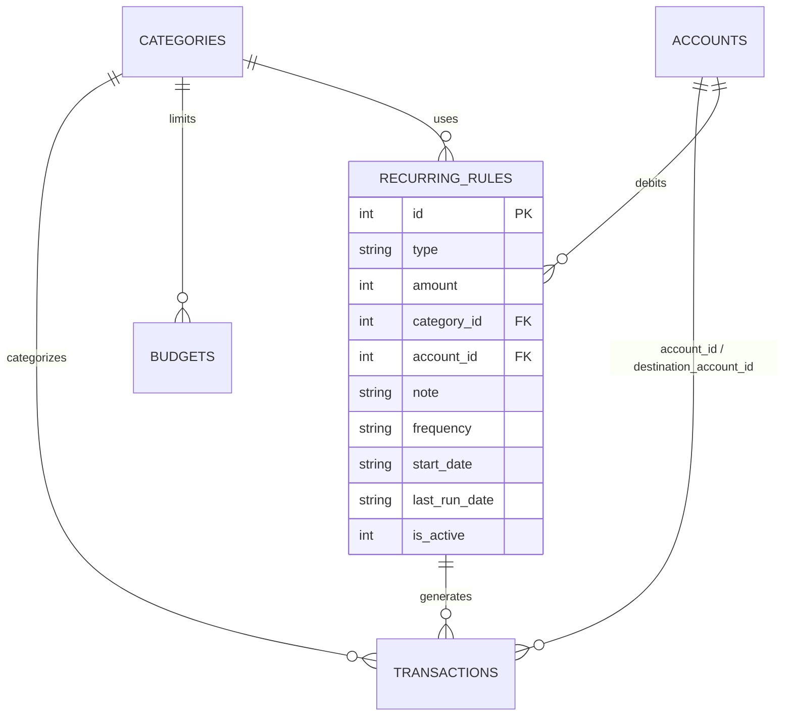
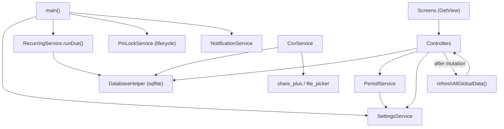
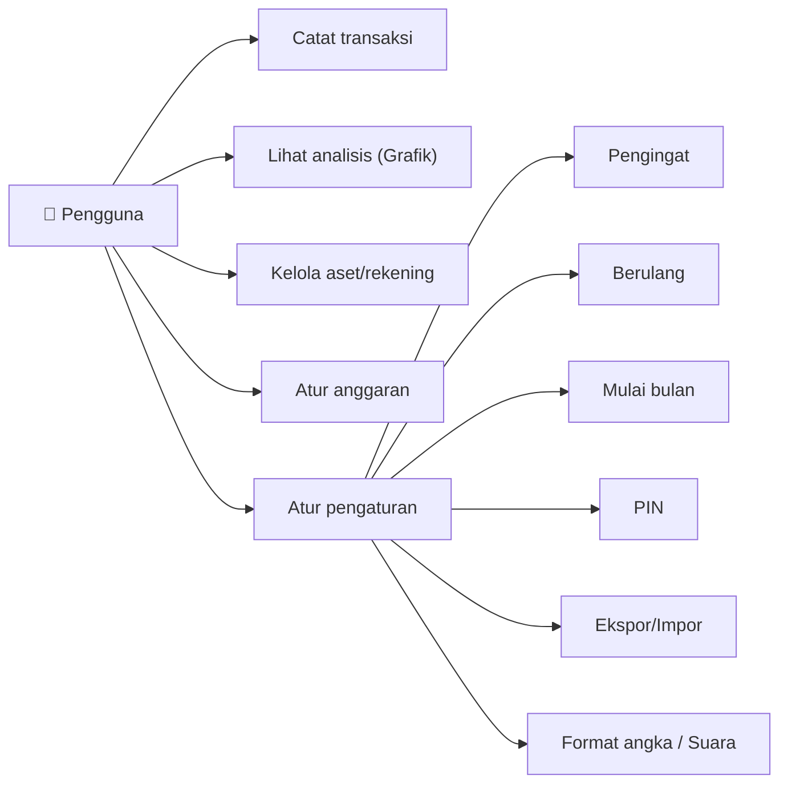

# Implementation Plan: UI Polish & Feature Completion Revamp

**Branch**: `001-ui-polish-revamp` (spec-only, working on `main`) | **Date**: 2026-10-25 | **Spec**: [spec.md](spec.md)
**Input**: Feature specification from `specs/001-ui-polish-revamp/spec.md`

## Summary

Replace the neon palette with a calm "slate" token set and route every color, snackbar and dialog
through shared tokens/helpers; fix data bugs A1–A6 plus two transfer bugs found during planning
(FR-017/018); simplify navigation (Grafik = single analysis tab, Laporan → "Aset", shared active
period, Indonesian copy, debug-only dev menu, Buku Kas removed); and build every Settings item for
real (daily reminder, recurring transactions, custom month start, PIN lock, CSV export/import,
number format, sound effect) plus a budget summary/over-budget warning on Riwayat.

## Technical Context

**Language/Version**: Dart 3.12.2 / Flutter 3.44.8 (pubspec SDK constraint ^3.1.0)
**Primary Dependencies**: get, sqflite, intl, fl_chart, table_calendar, flutter_slidable, tutorial_coach_mark, google_sign_in/googleapis (existing). **New**: flutter_local_notifications ^22.3.3, timezone ^0.11.2, flutter_timezone ^5.1.1, share_plus ^13.3.1, file_picker ^13.2.0, audioplayers ^6.8.1, cryptography ^2.9.0. All verified resolvable with `flutter pub add --dry-run`.
**Storage**: SQLite (`artavia.db`, version 10 → **11**: new `recurring_rules` table). Settings in existing `settings` key/value table.
**Testing**: `flutter_test` unit tests for pure logic (new `test/` dir); `flutter analyze`; manual acceptance per quickstart.md.
**Target Platform**: Android (primary; minSdk from Flutter default ≥21) and iOS.
**Project Type**: mobile (single Flutter app)
**Architecture Type**: monolith mobile app, feature-based GetX (`lib/page/<feature>/{screen,controller,binding}`), shared `lib/core/` (database, services, utils, models) and `lib/widgets/` (commons, components).
**Integration Target**: N/A (standalone, offline-first; only external call = existing Google Drive backup).
**Existing Design System**: Material 3 dark theme configured in `lib/main.dart`; tokens as top-level consts in `lib/widgets/commons/colors.dart` (part of `common.dart`); Material Icons + PNG asset icons (`assets/<group>/`) via `CategoryIcon`; `BouncyButton` press animation. No component library. → Keep this system; **replace token values**, add missing tokens, enforce usage.
**Performance Goals**: 60 fps scroll on Riwayat with 1,000 tx/month (NFR-002); startup recurring run < 300 ms for typical (<100) due occurrences.
**Constraints**: offline; no new network calls (NFR-003); non-destructive DB migration (NFR-004).
**Scale/Scope**: ~45 Dart files touched, ~6 new files/screens, 1 table.

## UI/UX & Screens (carried from spec)

- **Design reference**: none external; calm dark slate palette (below), approved in principle by user.
- **Screens**: see spec Screen Inventory. Changes per screen:
  - Riwayat: shared period header (Indonesian months), budget summary card (if budgets exist), no Buku Kas icon.
  - Grafik: + summary card (Pengeluaran / Pemasukan / Saldo) at top; Pekan navigable; Tahun = 12 monthly points; category sheet with Indonesian dates + tap → detail.
  - Aset (was Laporan): no TabBar; net worth (shared rule) + account actions + account list.
  - Saya: neutral header (no gold gradient), no Buku Kas, dev menu only in debug, stats refresh automatically.
  - Pengaturan: all items functional (reminder + time, recurring, month start, PIN, backup link, export, import, number format, sound, reset).
  - New: Transaksi Berulang list + form; PIN screen (setup / unlock / disable modes).
  - Tambah Transaksi: no-account empty state; over-budget warning after save.
  - Transfer: edit mode.
- **States**: as spec "Per-Screen Key States".
- **Flows**: toasts bottom/2 s; all destructive actions via `AppDialog.confirm`; changing period anywhere updates all monthly screens.

### Palette (final tokens)

| Token | Hex | Contrast vs `colorBackground` |
| ----- | --- | ---- |
| `colorBackground` | #111318 | — |
| `colorCard` | #181B21 | — |
| `colorSurface` | #20242C | — |
| `colorDivider` | #2A2F38 | — |
| `colorText` | #E7E9EE | 15.3:1 (card 14.2) |
| `colorGrey` (secondary text) | #8D94A3 | 6.1:1 (card 5.7) |
| `colorAccent` | #7AA2F7 | 7.4:1 (card 6.8) |
| `colorOnAccent` | #0F1115 | on accent 7.5:1 |
| `colorAccentDim` | #7AA2F7 @ 14% | backgrounds only |
| `colorIncome` | #5FBF8F | 8.3:1 (card 7.7) |
| `colorExpense` | #E07A7A | 6.4:1 (card 5.9) |
| `colorWarning` | #E0B25C | 9.5:1 |
| `colorWhite` | #FFFFFF | only for icons on colored fills; NOT text on expense (2.9:1) — destructive buttons use `colorOnAccent` text (6.5:1) |

`categoryPalette` (12): #E07A7A, #E59A6B, #E0B25C, #A3BE6C, #5FBF8F, #4FB6B0, #5FA8D3, #7AA2F7, #9D8CE6, #C987C9, #D98AA8, #8D94A3.
Radii: cards 12, buttons/icon tiles 10, chips 20.

## Constitution Check

*GATE: Must pass before Phase 0 research. Re-check after Phase 1 design.*

| Principle | Status | Notes |
| --------- | ------ | ----- |
| I. Local-First & Privacy | ✅ PASS | New packages are all on-device (local notifications, share sheet, file picker, local audio). No network. |
| II. Feature-Based GetX | ✅ PASS | New features get `page/<feature>/` with screen/controller/binding; new cross-cutting logic in `core/services` as `GetxService`. Settings logic moves out of `SettingsScreen` (StatefulWidget) into `SettingsController` — fixes an existing violation. |
| III. Single Source of Visual Truth | ✅ PASS (this feature enforces it) | All `Colors.*`/hex removed from pages; `AppToast`/`AppDialog` helpers. |
| IV. Consistent Data Mutations | ✅ PASS | Recurring inserts reuse balance-aware insert inside one DB transaction; net worth single function; refresh registry extended. |
| V. Honest, Simple UI | ✅ PASS | Buku Kas removed, dead settings built, dev menu `kDebugMode`. |
| Tech: new deps justified | ⚠ JUSTIFIED | See Complexity Tracking. |
| Tech: schema change migrates | ✅ | v11 `CREATE TABLE IF NOT EXISTS recurring_rules` in `onUpgrade` + `onCreate`. |

**Post-design re-check**: design added deps + one table (both covered above) and a lifecycle observer for PIN (no data flow change) → no new violations.

## Project Structure

### Documentation (this feature)

```text
specs/001-ui-polish-revamp/
├── spec.md
├── plan.md            # this file
├── research.md
├── data-model.md
├── quickstart.md
├── contracts/
│   ├── csv-format.md
│   └── settings-keys.md
├── checklists/requirements.md
└── tasks.md           # /scutum.tasks
```

### Source Code (repository root)

```text
lib/
├── main.dart                          # theme from tokens; service init; PIN gate; recurring run
├── core/
│   ├── database/database_helper.dart  # v11, range queries, recurring CRUD, import txn
│   ├── models/recurring_rule.dart     # NEW
│   ├── services/
│   │   ├── settings_service.dart      # NEW  cached prefs (GetxService)
│   │   ├── period_service.dart        # NEW  shared active month + start day
│   │   ├── recurring_service.dart     # NEW  due-date calc + run
│   │   ├── notification_service.dart  # NEW  daily reminder
│   │   ├── pin_lock_service.dart      # NEW  hash/verify + lifecycle lock
│   │   ├── sound_service.dart         # NEW  success chime
│   │   └── csv_service.dart           # NEW  export/parse/import
│   └── utils/
│       ├── currency_format.dart       # separator from SettingsService
│       ├── data_refresh.dart          # + Profile, Search
│       ├── finance_calc.dart          # NEW  net worth, trend buckets, search filter
│       └── date_format.dart           # + Indonesian month helpers
├── page/
│   ├── chart/ (summary card, trend fix)        ├── report/ (→ "Aset" only)
│   ├── home/ (budget card, period)             ├── profile/ (neutral header, debug menu)
│   ├── settings/ (+ settings_controller/binding)
│   ├── recurring/ (NEW list/form/controller/binding)
│   ├── pin/ (NEW pin_screen/controller/binding)
│   ├── transfer/ (edit mode)                   ├── add_transaction/ (no-account, budget warn)
│   ├── search/ transaction_detail/ budget/ calendar/ account_management/ category_management/
│   └── ledger/  ← DELETED
├── widgets/
│   ├── commons/colors.dart            # new tokens + categoryPalette
│   └── components/app_feedback.dart   # NEW AppToast + AppDialog
assets/sounds/success.wav              # NEW (generated, <20 KB)
test/                                  # NEW unit tests
android/app/build.gradle.kts           # core library desugaring (notifications)
android/app/src/main/AndroidManifest.xml  # notification receivers + POST_NOTIFICATIONS
```

**Structure Decision**: keep existing feature-based layout; `report/` folder keeps its name (only label changes) to avoid churn.

## Complexity Tracking

| Violation | Why Needed | Simpler Alternative Rejected Because |
| --------- | ---------- | ------------------------------------ |
| +flutter_local_notifications, timezone, flutter_timezone | FR-031a daily reminder must fire while app is closed | No built-in Flutter API schedules OS notifications |
| +share_plus | FR-031e hand CSV to user (Drive, WhatsApp, Files) | Writing to app-private dir only is invisible to user |
| +file_picker | FR-031f choose CSV from device | No built-in document picker |
| +audioplayers | FR-031h reliable chime | `SystemSound.click` is silent when OS touch sounds are off |
| +cryptography | PIN hashing with PBKDF2-HMAC-SHA256 600k (security standard) | `crypto` only offers raw SHA-256; hand-rolling PBKDF2 = roll-your-own crypto |
| New table `recurring_rules` | Persist rules + last run | Settings key/value can't hold structured, queryable rules safely |

## Technical Diagrams

### Data Design Decisions

| Source resource | Table(s) | Mapping | Rationale |
| --------------- | -------- | ------- | --------- |
| Transaksi | transactions | unchanged | — |
| Rekening | accounts | unchanged | — |
| Kategori | categories | unchanged (default colors re-seeded only on fresh install) | Don't overwrite user data |
| Anggaran | budgets | unchanged; keyed by period (year, month label) | Period start day shifts range, not key |
| Aturan Berulang | recurring_rules (FK category, account) | new, mirror spec entity | FR-031b |
| Pengaturan | settings | unchanged; new keys (contracts/settings-keys.md) | — |
| Buku Kas | — | removed (never persisted) | Q1 |

### Data Model (ERD)



### System Architecture



### Use Cases



### Internal Contract Overview (no network API)

| Operation | Interface | Purpose |
| --------- | --------- | ------- |
| CSV export/import | `CsvService` — [contracts/csv-format.md](contracts/csv-format.md) | File format contract |
| Preferences | `SettingsService` — [contracts/settings-keys.md](contracts/settings-keys.md) | Key names/values |
| Period range | `PeriodService.rangeFor(year, month) → (start, endExclusive)` | Shared month logic |
| Recurring | `RecurringService.dueDates(rule, today) → List<DateTime>`; `runDue()` | Generation |

## Implementation Phases (for /scutum.tasks)

1. **Foundation**: tokens, theme, `AppToast`/`AppDialog`, replace all hardcoded colors/snackbars/dialogs, category palette.
2. **Core services**: SettingsService, PeriodService, finance_calc, DB v11 + range queries, refresh registry.
3. **Bug fixes**: FR-010–018.
4. **Simplification**: FR-020–026, FR-030.
5. **Settings features**: FR-031a–h, FR-032.
6. **Budget integration**: FR-033.
7. **Tests & verification**: unit tests, analyze, format, quickstart walk-through.
