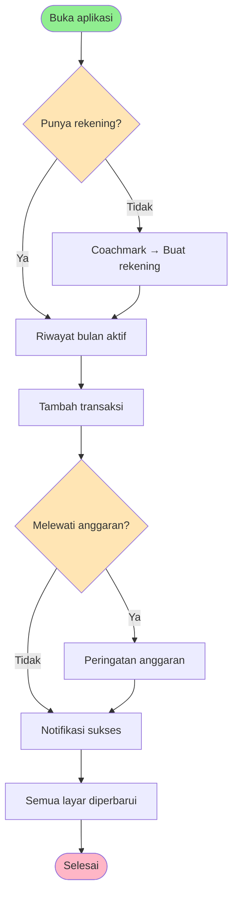

# Feature Specification: UI Polish & Feature Completion Revamp

**Feature Branch**: `001-ui-polish-revamp` (spec-only, no branch created)
**Created**: 2026-10-25
**Status**: Draft
**Input**: User description: "Tolong kerjakan semuanya dari fondasi warna boleh jika ada saran color palet yang lebih cocok simpel, smooth, dan clean silahkan gunakan color palet tersebut, ayo mulai dari fondasi warna, bug, penyederhanaan dan fitur yang belum selesai."

Context: builds on the full-app audit done in this session (sections A–C of the audit report).

## User Scenarios & Testing *(mandatory)*

### User Story 1 - Tampilan kalem dan konsisten (Priority: P1)

Pengguna membuka aplikasi dan semua layar memakai satu palet warna yang tenang (tanpa neon),
teks tidak menyilaukan, dan notifikasi/dialog terlihat sama di semua fitur.

**Why this priority**: Keluhan utama pengguna ("memusingkan, tidak nyaman di mata"); menyentuh setiap layar.

**Independent Test**: Buka setiap layar (Riwayat, Grafik, Laporan, Saya, Tambah Transaksi, Transfer,
Rekening, Kategori, Anggaran, Kalender, Cari, Detail, Pengaturan) dan semua dialog/snackbar; tidak ada
warna kuning/emas sisa palet lama, tidak ada neon, dan gaya notifikasi seragam.

**Acceptance Scenarios**:

1. **Given** aplikasi dibuka, **When** pengguna berpindah antar tab, **Then** warna aksen, pemasukan, dan pengeluaran sama di semua tab dan tidak ada warna dengan kejenuhan penuh di area besar.
2. **Given** pengguna menyimpan/menghapus/gagal menyimpan, **When** notifikasi muncul, **Then** bentuk, posisi (bawah), dan warna notifikasi seragam per jenis (sukses/peringatan/gagal).
3. **Given** pengguna membuat kategori, **When** memilih warna, **Then** semua pilihan warna terlihat jelas di latar gelap (tidak ada hitam).

---

### User Story 2 - Data selalu benar dan sinkron (Priority: P1)

Pengguna mencatat, mengedit, mencari, dan menghapus transaksi; angka di semua layar konsisten dan
tidak ada aksi yang membuka form salah atau membuat aplikasi crash.

**Why this priority**: Kepercayaan terhadap angka keuangan adalah inti aplikasi.

**Independent Test**: Jalankan skenario A1–A6 dari audit dan pastikan semua lulus.

**Acceptance Scenarios**:

1. **Given** ada transaksi transfer, **When** pengguna memilih filter "Transfer" di Cari, **Then** hanya transfer yang tampil.
2. **Given** hasil pencarian berisi kategori ber-ikon gambar, **When** hasil tampil, **Then** ikon gambar kategori tampil.
3. **Given** detail transaksi transfer terbuka, **When** pengguna menekan Edit, **Then** form Transfer yang terbuka dengan data terisi.
4. **Given** belum ada rekening, **When** pengguna menekan + untuk mencatat, **Then** aplikasi tidak crash dan mengarahkan pengguna membuat rekening terlebih dahulu.
5. **Given** ada rekening yang dikecualikan dari total, **When** pengguna melihat Kekayaan Bersih di Saya dan di Laporan, **Then** angkanya sama.
6. **Given** tampilan Grafik mode Tahun, **When** grafik tren tampil, **Then** sumbu menunjukkan 12 bulan dan nilai tidak tertumpuk per tanggal.
7. **Given** mode Pekan, **When** pengguna menekan ‹ / ›, **Then** periode berpindah ke pekan sebelumnya/berikutnya.
8. **Given** layar Cari atau Saya sedang terbuka di tumpukan, **When** transaksi/rekening diubah atau seluruh data direset, **Then** semua layar menampilkan data terbaru tanpa refresh manual.

---

### User Story 3 - Navigasi lebih sederhana (Priority: P2)

Pengguna menemukan analisis di satu tempat, bulan yang dipilih berlaku di semua tampilan bulanan,
copy berbahasa Indonesia konsisten, dan menu developer tidak terlihat di build rilis.

**Why this priority**: Mengurangi kebingungan dan duplikasi; nilai besar dengan risiko rendah.

**Independent Test**: Pilih bulan Agustus di Riwayat → Grafik (mode Bulan), Laporan, dan Anggaran menampilkan Agustus.

**Acceptance Scenarios**:

1. **Given** pengguna di tab Grafik, **When** melihat analisis pengeluaran, **Then** ringkasan pemasukan/pengeluaran/saldo dan distribusi kategori ada di tab ini; tab Laporan hanya berisi aset & rekening (tidak ada donut duplikat).
2. **Given** pengguna mengganti bulan di salah satu layar bulanan, **When** membuka layar bulanan lain, **Then** bulan yang sama ditampilkan.
3. **Given** picker bulan di Riwayat, **When** dibuka, **Then** nama bulan berbahasa Indonesia (Mei, Agu, Okt, Des).
4. **Given** build rilis, **When** pengguna membuka Saya, **Then** menu "Generate Dummy Data" tidak tampil.
5. **Given** pengguna menekan kategori di Grafik, **When** daftar transaksinya tampil, **Then** tanggal tampil dalam format Indonesia dan tiap transaksi bisa dibuka ke detail.
6. **Given** pengguna menghapus rekening yang punya transaksi, **When** dialog konfirmasi tampil, **Then** pesan menjelaskan dengan benar bahwa rekening dengan riwayat tidak dapat dihapus.

---

### User Story 4 - Tidak ada fitur palsu (Priority: P2)

Setiap menu/tombol/toggle yang terlihat melakukan apa yang dikatakannya. Fitur yang belum dibangun
tidak ditampilkan.

**Why this priority**: Constitution Prinsip V (Honest, Simple UI).

**Independent Test**: Tekan setiap item di Pengaturan, Buku Kas, dan Saya; masing-masing menghasilkan aksi nyata atau item tersebut tidak ada.

**Acceptance Scenarios**:

1. **Given** aplikasi dibuka, **When** pengguna mencari menu Buku Kas, **Then** menu tersebut tidak ada di Riwayat maupun Saya.
2. **Given** Pengaturan, **When** pengguna menekan item apa pun, **Then** item melakukan aksi nyata (FR-031a–h).
5. **Given** aturan berulang bulanan tanggal 1 dan aplikasi tidak dibuka 2 bulan, **When** aplikasi dibuka, **Then** 2 transaksi tercatat tepat sekali dan membuka ulang aplikasi tidak menambah duplikat.
6. **Given** Kunci PIN aktif, **When** aplikasi dibuka atau kembali dari latar belakang, **Then** layar PIN tampil dan data tidak terlihat sebelum PIN benar.
7. **Given** file CSV hasil ekspor, **When** diimpor ke data kosong, **Then** jumlah dan total transaksi sama dengan sumbernya.
3. **Given** Pengaturan → "Cadangkan Data", **When** ditekan, **Then** pengguna diarahkan ke fitur Cloud Backup yang sudah ada (tanpa duplikasi).
4. **Given** pengguna punya anggaran bulan ini, **When** membuka tab Riwayat, **Then** ringkasan anggaran (terpakai/total) terlihat dan dapat ditekan untuk membuka Anggaran; jika suatu kategori melewati batas, pengguna diberi tahu saat menyimpan pengeluaran di kategori itu.

---

### Edge Cases

- Tidak ada rekening sama sekali saat membuka Tambah Transaksi atau Transfer.
- Hanya satu rekening saat membuka Transfer (sudah ditangani; pastikan gaya baru).
- Rekening dihapus setelah transaksi dibuat (transaksi tanpa rekening tidak boleh membuat edit menduplikasi data).
- Kategori dengan warna lama yang tersimpan (mis. neon/hitam) tetap ditampilkan; tidak dimigrasi paksa.
- Bulan tanpa data di Grafik mode Tahun → empty state yang sama dengan mode lain.
- Reset seluruh data saat layar lain masih di memori.

## Requirements *(mandatory)*

### Functional Requirements

**Fondasi warna & komponen**
- **FR-001**: Aplikasi MUST memakai satu palet kalem terpusat (lihat UI/UX → Palet) untuk latar, kartu, permukaan, garis, teks utama, teks sekunder, aksen, pemasukan, pengeluaran, dan peringatan.
- **FR-002**: Tidak ada layar yang memakai warna di luar palet terpusat (kecuali transparan dan warna yang dipilih pengguna untuk kategori/rekening).
- **FR-003**: Pilihan warna kategori dan rekening MUST berasal dari satu daftar ~12 warna dengan kejenuhan setara, semuanya terbaca di latar gelap.
- **FR-004**: Semua notifikasi (sukses/peringatan/gagal/info) MUST tampil dengan satu gaya bersama di posisi bawah.
- **FR-005**: Semua dialog konfirmasi MUST memakai satu gaya bersama (aksi destruktif berwarna pengeluaran, batal netral).
- **FR-006**: Date picker dan elemen bawaan sistem (switch, progress, refresh) MUST mengikuti palet.

**Perbaikan bug**
- **FR-010**: Filter "Transfer" di Cari MUST hanya menampilkan transfer; hasil MUST menampilkan ikon gambar kategori.
- **FR-011**: Edit dari Detail Transaksi MUST membuka form yang sesuai jenisnya (transfer → Transfer) dengan data lengkap (termasuk rekening tujuan).
- **FR-012**: Menyimpan transaksi tanpa rekening MUST tidak crash; pengguna diberi pesan dan jalan pintas membuat rekening.
- **FR-013**: Kekayaan Bersih, Total Aset, dan Total Liabilitas MUST dihitung dengan satu aturan (mengecualikan rekening yang ditandai "exclude") di semua layar.
- **FR-014**: Grafik mode Tahun MUST mengelompokkan tren per bulan (12 titik); mode Pekan MUST mengelompokkan per hari dalam pekan (7 titik) dan dapat bernavigasi ke pekan lain.
- **FR-015**: Setiap perubahan data (termasuk reset & restore) MUST memperbarui semua layar yang sedang ada di memori, termasuk Saya dan Cari.
- **FR-016**: Edit transaksi yang rekening lamanya tidak ada lagi MUST tidak menghasilkan transaksi ganda.
- **FR-017**: Edit transfer MUST memuat data transfer lama (rekening asal/tujuan, nominal, biaya admin, tanggal, catatan) dan menyimpan sebagai perubahan, bukan transfer baru. *(ditemukan saat plan)*
- **FR-018**: Menghapus transfer yang memiliki biaya admin MUST mengembalikan saldo kedua rekening dengan tepat (termasuk biaya admin). *(ditemukan saat plan)*

**Penyederhanaan**
- **FR-020**: Ringkasan & distribusi pengeluaran bulanan MUST hanya ada di tab Grafik; tab Laporan menjadi tab "Aset" (kekayaan bersih + daftar rekening).
- **FR-021**: Bulan aktif MUST dibagikan antara Riwayat, Grafik (mode Bulan), dan Anggaran.
- **FR-022**: Semua label bulan/hari MUST berbahasa Indonesia.
- **FR-023**: Menu developer MUST hanya tampil pada build debug.
- **FR-024**: Daftar transaksi per kategori di Grafik MUST berformat tanggal Indonesia dan dapat dibuka ke detail.
- **FR-025**: Copy dialog hapus rekening MUST akurat.
- **FR-026**: Kode/elemen yang tidak terpakai (mis. state speed-dial FAB) MUST dihapus.

**Fitur yang belum selesai**
- **FR-030**: Menu Buku Kas (ikon di Riwayat dan item di Saya) MUST dihapus dari UI beserta layar dummy-nya. *(Q1 → hapus menu dulu)*
- **FR-031**: Semua item Pengaturan MUST berfungsi nyata *(Q2 → bangun semuanya)*:
  - **FR-031a Pengingat Harian**: bila aktif, pengguna menerima notifikasi lokal setiap hari pada jam yang dipilih (default 20:00); jam dapat diubah; mematikan toggle membatalkan pengingat.
  - **FR-031b Transaksi Berulang**: pengguna dapat membuat, melihat, mengubah, dan menghapus aturan berulang (pengeluaran/pemasukan, nominal, kategori, rekening, catatan, frekuensi harian/mingguan/bulanan, tanggal mulai). Saat aplikasi dibuka, semua kejadian yang jatuh tempo hingga hari ini dicatat otomatis tepat satu kali, dengan saldo diperbarui.
  - **FR-031c Mulai Bulan Pada**: pengguna memilih tanggal 1–28 sebagai awal periode bulanan; Riwayat, Grafik (mode Bulan), dan Anggaran memakai periode tersebut (mis. mulai 25 → periode "Okt" = 25 Sep–24 Okt).
  - **FR-031d Kunci PIN**: mengaktifkan meminta pembuatan PIN 4 digit (dua kali konfirmasi); saat aplikasi dibuka atau kembali dari latar belakang, PIN wajib dimasukkan; mematikan memerlukan PIN; PIN disimpan dalam bentuk hash.
  - **FR-031e Ekspor CSV**: mengekspor semua transaksi ke file CSV dan membuka lembar berbagi sistem.
  - **FR-031f Impor CSV**: memilih file CSV berformat sama dengan ekspor; menampilkan pratinjau jumlah baris valid/tidak valid sebelum impor; kategori/rekening yang belum ada dibuat otomatis; saldo diperbarui.
  - **FR-031g Format Angka**: pilihan pemisah ribuan titik (1.000) atau koma (1,000); berlaku pada semua nominal yang tampil.
  - **FR-031h Efek Suara**: bila aktif, suara pendek diputar saat transaksi berhasil disimpan.
- **FR-032**: Pengaturan "Cadangkan Data" MUST mengarah ke Cloud Backup yang sudah ada.
- **FR-033**: Tab Riwayat MUST menampilkan ringkasan anggaran bulan aktif jika ada anggaran; menyimpan pengeluaran yang membuat kategori melewati anggaran MUST memunculkan peringatan.

### Non-Functional Requirements

- **NFR-001**: Kontras teks utama terhadap latar ≥ 7:1 dan teks sekunder ≥ 4.5:1; warna pemasukan/pengeluaran/aksen ≥ 4.5:1 terhadap kartu.
- **NFR-002**: Tidak ada penurunan kelancaran: perpindahan tab dan scroll daftar transaksi tetap mulus pada data 1.000 transaksi/bulan.
- **NFR-003**: Data tetap lokal; tidak ada panggilan jaringan baru selain Google Drive yang sudah ada.
- **NFR-004**: Perubahan skema (jika ada) MUST bermigrasi tanpa kehilangan data pengguna lama.

### Key Entities

- **Transaksi**: jenis (pengeluaran/pemasukan/transfer), nominal, kategori, rekening asal, rekening tujuan (transfer), tanggal, catatan.
- **Rekening**: nama, jenis, saldo, mata uang, ikon, warna, flag "dikecualikan dari total".
- **Kategori**: nama, jenis, ikon, warna (dari palet).
- **Anggaran**: kategori, bulan, batas nominal; "terpakai" dihitung dari transaksi.
- **Pengaturan**: pasangan kunci-nilai (preferensi pengguna).
- **Aturan Berulang**: jenis, nominal, kategori, rekening, catatan, frekuensi (harian/mingguan/bulanan), tanggal mulai, tanggal terakhir dicatat, status aktif. Menghasilkan Transaksi.

## Success Criteria *(mandatory)*

### Measurable Outcomes

- **SC-001**: 0 penggunaan warna di luar palet terpusat pada layar aplikasi (diverifikasi pencarian kode).
- **SC-002**: 100% skenario penerimaan US2 lulus pada uji manual.
- **SC-003**: 0 item UI yang terlihat tanpa aksi nyata (diverifikasi dengan menekan setiap item di Saya & Pengaturan).
- **SC-004**: Angka Kekayaan Bersih identik di semua layar untuk 100% kombinasi rekening uji.
- **SC-005**: Pengguna menemukan analisis pengeluaran bulanan di 1 tempat (sebelumnya 2).
- **SC-006**: Pemeriksaan statis tetap 0 masalah setelah perubahan.

## UI/UX & Screens *(mandatory when the feature has a user interface)*

### Design Reference

- **Design source**: none — direction proposed here (calm dark "slate" palette) and approved in principle by the user ("silahkan gunakan color palet tersebut").
- **Look & feel**: gelap, kalem, minimalis; aksen tunggal biru lembut; hijau/merah semantik yang diredam; kartu tanpa bayangan berat; radius seragam (sudut 12 untuk kartu, 10 untuk tombol/ikon).
- **Existing UI to match**: struktur layar Artavia saat ini (tidak didesain ulang total; hanya warna, konsistensi, dan penyederhanaan).

**Palet (diusulkan, final di plan):**

| Peran | Warna |
| ----- | ----- |
| Latar | #111318 |
| Kartu | #181B21 |
| Permukaan bertingkat | #20242C |
| Garis | #2A2F38 |
| Teks utama | #E7E9EE |
| Teks sekunder | #8D94A3 |
| Aksen | #7AA2F7 |
| Teks di atas aksen | #0F1115 |
| Pemasukan | #5FBF8F |
| Pengeluaran | #E07A7A |
| Peringatan | #E0B25C |

Palet kategori (12): #E07A7A, #E59A6B, #E0B25C, #A3BE6C, #5FBF8F, #4FB6B0, #5FA8D3, #7AA2F7, #9D8CE6, #C987C9, #D98AA8, #8D94A3.

### Screen Inventory

| Screen | Purpose | Serves story | Key data shown | Primary actions |
| ------ | ------- | ------------ | -------------- | --------------- |
| Riwayat (tab) | Daftar transaksi bulan aktif | US1, US2, US4 | ringkasan bulan, ringkasan anggaran, transaksi per hari | ganti bulan, buka detail, edit/hapus |
| Grafik (tab) | Analisis pengeluaran | US2, US3 | ringkasan, donut kategori, tren | ganti mode/periode, buka kategori |
| Aset (tab, eks-Laporan) | Kekayaan & rekening | US2, US3 | kekayaan bersih, aset, liabilitas, rekening per jenis | tambah/kelola/edit rekening |
| Saya (tab) | Menu & statistik | US3, US4 | statistik, menu | navigasi, backup |
| Tambah Transaksi | Mencatat | US2 | kategori, nominal, rekening | simpan |
| Transfer | Pindah saldo | US2 | rekening asal/tujuan, nominal, biaya | simpan |
| Detail Transaksi | Melihat 1 transaksi | US2 | semua atribut | edit, hapus |
| Cari | Mencari transaksi | US2 | hasil | filter, buka detail |
| Anggaran | Batas per kategori | US4 | terpakai vs batas | tambah/edit/hapus |
| Pengaturan | Preferensi | US4 | semua item FR-031 | ubah preferensi, ekspor/impor |
| Transaksi Berulang | Kelola aturan berulang | US4 | daftar aturan, jadwal berikutnya | tambah/edit/hapus/nonaktifkan |
| Kunci PIN | Membuka aplikasi | US4 | papan angka PIN | masukkan/buat PIN |
| Rekening, Kategori, Kalender | Pengelolaan/tampilan | US1 | — | — (hanya palet & konsistensi) |

### Per-Screen Key States

- **Riwayat**: loading = indikator di area daftar; empty = "Belum ada transaksi bulan ini" + petunjuk tombol +; populated = ringkasan bulan + (bila ada) kartu anggaran.
- **Grafik**: empty = "Belum ada data pada periode ini"; populated = ringkasan → donut → tren → daftar kategori.
- **Aset**: empty = "Belum ada rekening" + tombol Tambah Rekening.
- **Tambah Transaksi tanpa rekening**: pesan "Buat rekening terlebih dahulu" + tombol menuju Tambah Rekening.
- **Cari**: awal = petunjuk; kosong = "Tidak ada hasil"; hasil = jumlah + daftar.

### Primary Interactions & Flows

- Notifikasi selalu muncul dari bawah, otomatis hilang ±2 detik.
- Aksi destruktif selalu melalui dialog konfirmasi bergaya sama.
- Mengganti bulan di satu layar bulanan memperbarui layar bulanan lain.

## Business Process Flow *(visual aid)*

### Primary User Journey Flow

## Business Actors & Interactions

| Actor | Role | Key Interactions |
| ----- | ---- | ---------------- |
| Pengguna | Pemilik data keuangan pribadi | mencatat, menganalisis, mengelola rekening/kategori/anggaran |
| Sistem | Aplikasi lokal | menyimpan data, menjaga saldo konsisten, memperbarui semua layar |

## Assumptions

- Palet di atas disetujui pengguna secara umum ("silahkan gunakan"); nilai hex boleh disetel halus di plan untuk memenuhi NFR-001.
- Warna kategori/rekening yang sudah tersimpan tidak dimigrasi; hanya pilihan baru yang memakai palet baru. Warna default kategori bawaan (dari data awal) diperbarui ke palet baru.
- Tab "Laporan" diganti nama menjadi "Aset" karena isinya tinggal aset & rekening.
- Bulan bersama hanya untuk layar bulanan (Riwayat, Grafik-Bulan, Anggaran); Kalender tetap mandiri karena navigasinya per hari.
- Menu developer disembunyikan di rilis, bukan dihapus.
- Pengaturan "Cadangkan Data" diarahkan ke Cloud Backup (bukan fitur baru).
- Tidak ada perubahan pada logika Google Drive dan versi dependensi yang ada.
- Q2 "bangun semuanya" berarti paket baru untuk notifikasi lokal, berbagi/pilih file, dan audio diizinkan (dijustifikasi di plan).
- Kunci PIN: tidak ada pemulihan PIN di luar "Reset Seluruh Data" — karena data lokal tanpa akun; PIN lupa = reset (diberi peringatan saat membuat PIN).
- Impor CSV menambahkan data (tidak menimpa); duplikat tidak dideteksi otomatis.
- Mulai Bulan Pada tidak mengubah Kalender (tetap bulan kalender).
- Notifikasi pengingat hanya lokal; pada Android 13+ izin notifikasi diminta saat toggle diaktifkan.
