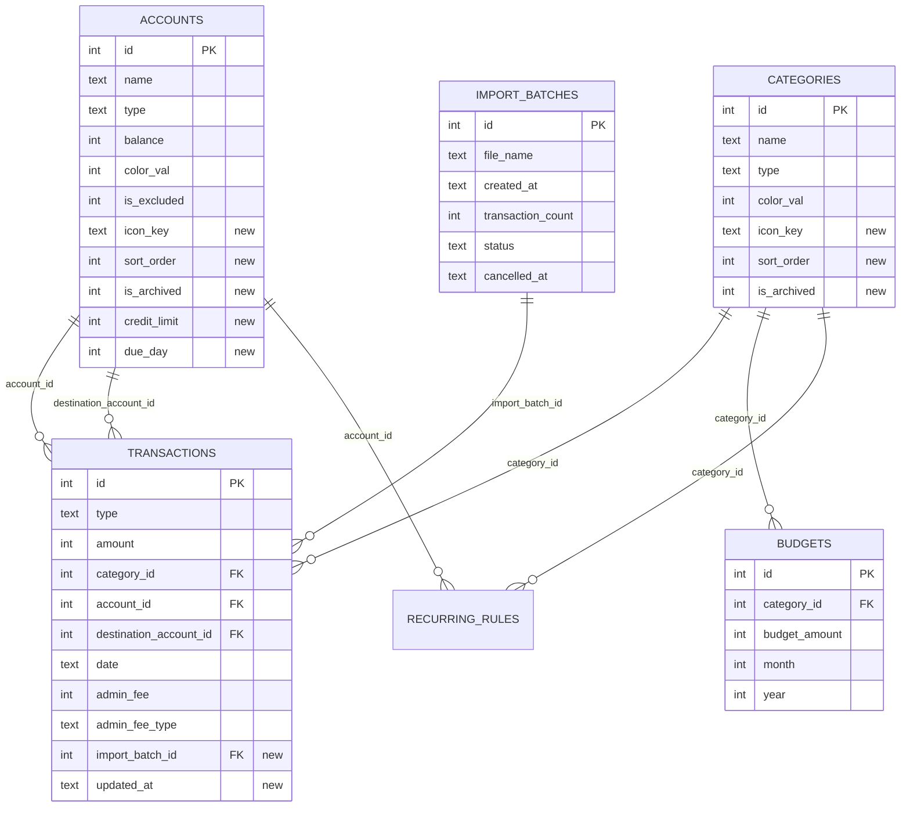

# Data Model: Kobalt Redesign

Source of truth: spec **Key Entities** + [inputs/kobalt-design-digest.md](inputs/kobalt-design-digest.md).
Storage: existing local SQLite (`artavia.db`), version **11 → 12** with a non-destructive
`onUpgrade` (constitution Technology Constraints). Existing tables are extended, not redesigned.

## Schema changes (v12)

### `transactions` (extended)

| Column | Type | Rule | New |
|---|---|---|---|
| id | INTEGER PK | — | |
| type | TEXT NOT NULL | `pengeluaran` \| `pemasukan` \| `transfer` | |
| amount | INTEGER NOT NULL | > 0 (FR-008) | |
| category_id | INTEGER FK categories | required unless transfer | |
| note | TEXT NOT NULL | ≤ 200 chars | |
| account_id | INTEGER FK accounts | required | |
| destination_account_id | INTEGER FK accounts | transfer only, ≠ account_id | |
| date | TEXT NOT NULL (ISO-8601) | — | |
| admin_fee | INTEGER NOT NULL DEFAULT 0 | ≥ 0; < amount when bearer = received | |
| admin_fee_type | TEXT | `Pengirim` (saldo asal) \| `Penerima` (uang diterima) | |
| import_batch_id | INTEGER FK import_batches ON DELETE SET NULL | null for manual entries | ✅ |
| updated_at | TEXT | ISO-8601, set on every insert/update | ✅ |

Migration: `updated_at` backfilled with `date`.

### `categories` (extended)

| Column | Type | Rule | New |
|---|---|---|---|
| id, name, type, color_val | (existing) | name ≤ 30 chars; color one of 12 palette entries | |
| icon_code, icon_path | (existing, legacy) | read only for migration; no longer written | |
| icon_key | TEXT | Lucide key from `IconRegistry` (107) | ✅ |
| sort_order | INTEGER NOT NULL DEFAULT 0 | manual drag order per type | ✅ |
| is_archived | INTEGER NOT NULL DEFAULT 0 | 0/1 | ✅ |

Migration: `icon_key` filled from a fixed `legacyIconMap` (icon_path / icon_code → Lucide key);
`sort_order` = current id order; legacy `color_val` snapped to nearest of the 12 palette colors
(blue `0xFF7AA2F7` → `0xFF5B8CFF`).

### `accounts` (extended)

| Column | Type | Rule | New |
|---|---|---|---|
| id, name, type, balance, currency_code, color_val, is_excluded | (existing) | — | |
| icon_code, icon_path | (existing, legacy) | migration only | |
| icon_key | TEXT | Lucide key | ✅ |
| sort_order | INTEGER NOT NULL DEFAULT 0 | — | ✅ |
| is_archived | INTEGER NOT NULL DEFAULT 0 | archived accounts hidden from pickers | ✅ |
| credit_limit | INTEGER | Kartu Kredit only | ✅ |
| due_day | INTEGER | 1–31, Kartu Kredit only | ✅ |

Account type → display group (Rekening screen, FR-020):

| Group (UI) | Stored `type` values | Side |
|---|---|---|
| Kas & bank | Kas Tunai, Bank, Tabungan | Aset |
| E-wallet | Dompet Digital | Aset |
| Investasi | Investasi, Investasi Aset | Aset |
| Kartu kredit & pinjaman | Kartu Kredit, Pinjaman | Liabilitas |
| Lainnya | Lainnya | Aset |

Net worth = Σ asset balances − Σ |liability balances|, excluding `is_excluded` and archived
accounts — one function in `finance_calc.dart` used by every screen (Principle IV).

### `import_batches` (new)

| Column | Type | Rule |
|---|---|---|
| id | INTEGER PK | — |
| file_name | TEXT NOT NULL | — |
| created_at | TEXT NOT NULL | ISO-8601 |
| transaction_count | INTEGER NOT NULL | rows committed |
| status | TEXT NOT NULL | `active` \| `cancelled` |
| cancelled_at | TEXT | set on cancel |

Derived state: `expired` when `status = active` and `now − created_at > 7 days`.

State lifecycle: `active` → `cancelled` (user, ≤ 7 days) · `active` → `expired` (time).

### `settings` (existing key/value — new keys)

| Key | Value | Default |
|---|---|---|
| theme_mode | `system` \| `dark` \| `light` | system |
| text_scale | `system` \| `0.9` \| `1.0` \| `1.15` \| `1.3` \| `1.5` | system |
| reduce_transparency | bool | false |
| hide_on_open | bool | false |
| haptics | bool | true (replaces `sound_effect`) |
| last_account_id | int | first account |
| recent_searches | JSON string[] (max 5) | [] |
| transfer_fee:&lt;from&gt;:&lt;to&gt; | JSON `{fee:int, bearer:"Pengirim"\|"Penerima"}` | — |
| backup_auto | bool | true once connected |
| backup_wifi_only | bool | true |
| backup_locked | bool | false |
| backup_hint | string | — |
| last_backup_at | ISO-8601 | — |
| last_backup_bytes / last_backup_tx | int | — |

The backup password itself is never stored.

## In-memory / non-persisted models

- **AppPalette** — all color tokens for one brightness (dark, light) + `categoryPalette` (12).
- **IconEntry** — `key`, `IconData`, `label` (ID), `group` (13 groups), `isExtra`.
- **CalcState** (Catat keypad) — `expression` tokens, `result:int`, `isValid` (result > 0),
  `activeField` (`amount` | `fee`).
- **TransferDraft** — from, to, amount, fee, bearer → derived `sourceDelta`, `destDelta`,
  `feeExpense`, `shortfall` (warning when source balance < sourceDelta).
- **DeletedSnapshot** — full transaction row kept 5 s for undo.
- **ImportPreview** — `ready[]`, `duplicates[]`, `invalid[{row, reason}]`,
  `newCategories[{name, action: create|merge(id)}]`, `newAccounts[{name, action}]`, period range.
- **ColumnMapping** — artavia field → source column index | `fromSign` | `unused`; date format;
  thousand separator; header row flag.
- **BackupEntry** — Drive file id, created, device, txCount, accountCount, bytes, locked.

## ERD

## Validation rules (from FRs)

- Amount > 0 after calculator evaluation; ÷ rounds half-up to whole rupiah (edge case).
- Transfer: from ≠ to; with bearer `Penerima`, fee < amount; shortfall only warns (FR-013).
- Category name 1–30 chars, unique per type among non-archived.
- Delete account/category with transactions → archive offered first (FR-021); hard delete
  removes its transactions through the balance-reverting path.
- Import: date and amount mapped (required); unparseable date/amount → invalid row.
