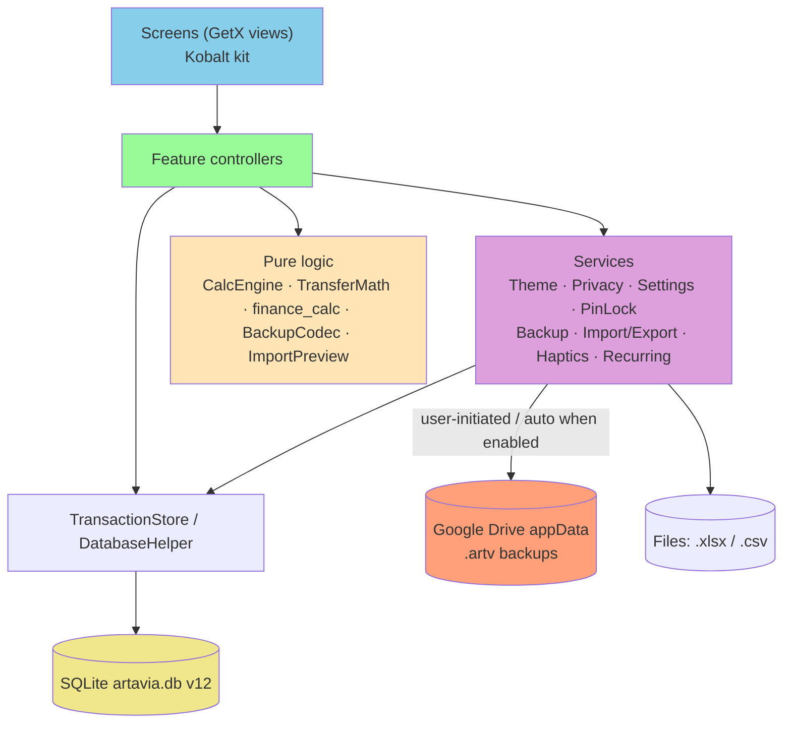
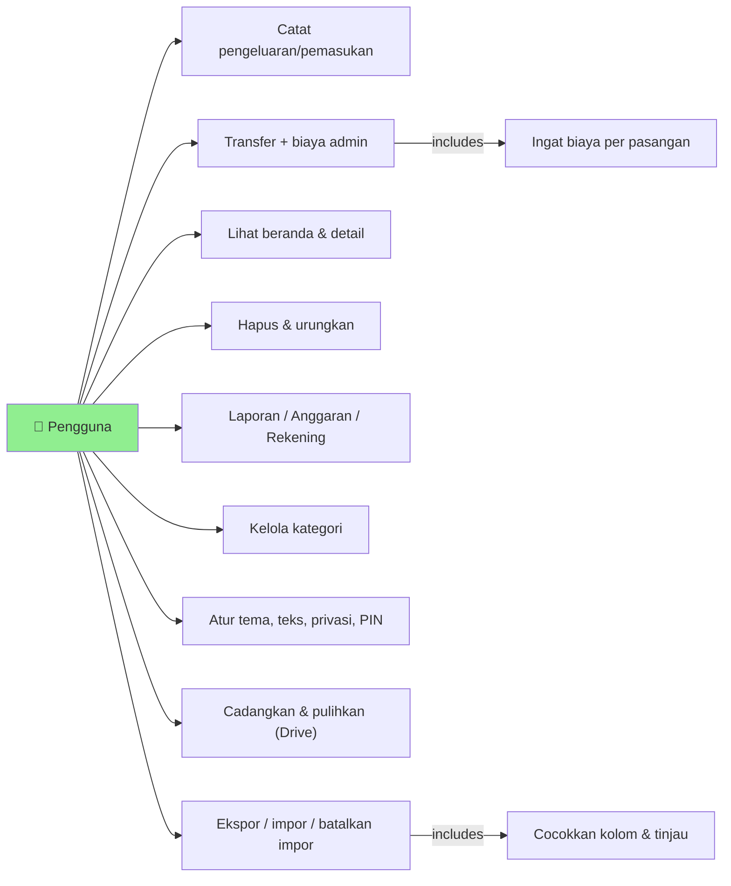
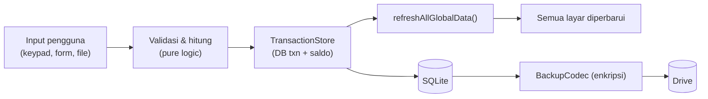
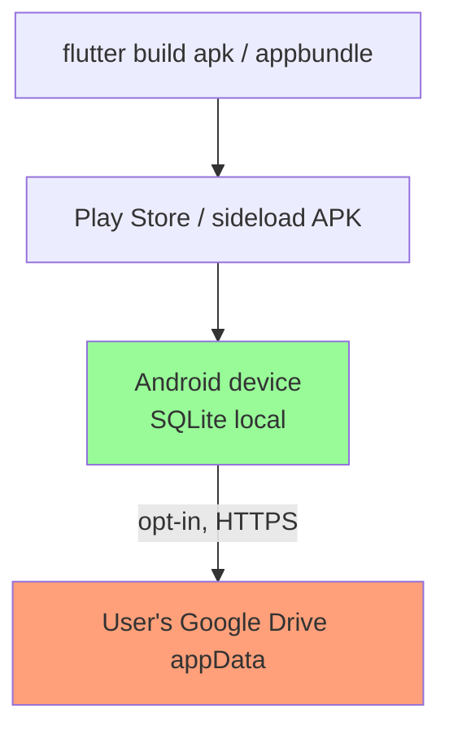

# Implementation Plan: Kobalt Redesign — Tampilan, Flow & Komponen

**Branch**: `002-kobalt-redesign` (spec-only; currently on `main`) | **Date**: 2026-10-29 | **Spec**: [spec.md](spec.md)
**Input**: Feature specification from `specs/002-kobalt-redesign/spec.md`

## Summary

Re-skin the whole Flutter app to the "Kobalt" design board (dark + light tokens, Plus Jakarta
Sans, glass layers, one ambient orb, shared component kit, 107 Lucide icons) and adopt the
board's flows: 4-tab navigation with a raised Catat button, unified Catat screen with calculator
keypad and Transfer segment, per-pair remembered admin fees, global privacy mode, 5-second
undo delete, merged Laporan (Minggu/Bulan/Tahun), grouped Rekening with archive, Anggaran
attention groups and suggestions, Kategori with 12 colors/107 icons and drag order, reorganised
Pengaturan with text size / reduce transparency / theme / haptics, PIN with biometrics,
encrypted Google Drive backups with restore-on-new-phone, and Excel/CSV export + 3-step import
with a 7-day undo history. Delivered in priority slices P1 → P3 on top of the existing GetX
feature folders; DB moves to v12 with a non-destructive migration.

## Technical Context

**Language/Version**: Dart SDK ^3.1, Flutter stable
**Primary Dependencies**: existing — get, intl (id_ID), sqflite, fl_chart, table_calendar, google_sign_in, googleapis, file_picker, share_plus, cryptography, flutter_slidable, path_provider. **New** — `lucide_icons_flutter` (icons, R3), `archive` + `xml` (in-house xlsx codec, R8), `local_auth` (fingerprint, R11), `connectivity_plus` (Wi-Fi-only backup, R10). **Removed** — `audioplayers` (sound replaced by haptics, R13); legacy PNG category icons under `assets/<group>/`.
**Storage**: local SQLite `artavia.db` v11 → v12 (see [data-model.md](data-model.md)); `settings` key/value for preferences; Drive `appDataFolder` for encrypted `.artv` backups.
**Testing**: `flutter test` with `sqflite_common_ffi` for DB/migration tests; pure-logic unit tests for calculator, transfer math, import preview, backup format, palette/icon registry.
**Target Platform**: Android (primary), iOS build kept compiling.
**Project Type**: mobile (single Flutter app)
**Architecture Type**: monolithic Flutter app, feature-based GetX (`lib/page/<feature>/` screen + controller + binding), shared services in `lib/core/services/`, DB in `lib/core/database/` — detected from repo + CODING_STYLE.md.
**Integration Target**: N/A (standalone app; only external system is the user's Google Drive).
**Existing Design System**: Material 3 widgets themed in `lib/main.dart` `buildAppTheme()`; tokens in `lib/widgets/commons/colors.dart` (calm slate dark palette from 001, already matches Kobalt latar/kartu/permukaan/garis/teks); shared helpers `widgets/components/app_feedback.dart`, `bouncy_button.dart`, `menu_group.dart`, `type_switcher.dart`; Material Icons + PNG category icons. **This feature replaces it with the Kobalt kit** in `lib/widgets/kobalt/` and the `AppPalette` token source — no second parallel system remains afterwards.
**Performance Goals**: ≥ 55 fps scrolling with glass on mid-range Android (NFR-004); tab switch / post-save refresh < 300 ms at 5 000 transactions (NFR-003).
**Constraints**: offline-first, no network except user-initiated Drive (Principle I); min touch target 44 px; min text 12 px at 100 %; Bahasa Indonesia copy.
**Scale/Scope**: ~45 board screens/states → ~22 Flutter routes/screens; ~70 Dart files touched; single user, up to ~50 000 transactions.

## UI/UX & Screens (carried from spec)

- **Design reference**: `inputs/01–04*.png` boards + [kobalt-design-digest](inputs/kobalt-design-digest.md) (token values verbatim from the attached HTML).
- **Screens** (route → states → actions):
  - Transaksi (home tab) → empty-no-account (first account form), empty-no-tx, populated, privacy, undo snackbar → search, calendar, eye, filter chips, period ‹ ›, open detail.
  - Catat (`addTransactionRoute`, modal ×) → zero, computing, error (−, red, Simpan disabled) → keypad, category grid/"Lihat semua", account & date pickers, note, segment.
  - Transfer (same modal, Transfer segment) → remembered fee, no fee, manual fee, shortfall warning → swap, chips, bearer segment.
  - Detail transaksi → populated → ubah, berulang, duplikat, hapus(+undo).
  - Cari → recent, results, nihil → filters, clear, suggestion.
  - Kalender → month grid, day list → ‹ ›, Hari ini.
  - Laporan (tab) → week/month/year, privacy note, empty period → range segment, period ‹ ›, type chip.
  - Rekening (tab) → grouped list, archived link, delete dialog → add, collapse, archive/delete.
  - Anggaran → populated (perlu perhatian/aman), empty (+saran) → add, pakai.
  - Pengaturan (tab) → normal, backup-failed toast → navigate, switches, reset.
  - Kategori / Kategori baru → list (reorder), archived link / form with live preview.
  - Ukuran teks, Kunci PIN (normal/wrong), Drive (disconnected/connected/running/failed), Cadangan ditemukan (normal/wrong password), Ekspor, Impor 1/2/3, Riwayat impor (+confirm dialog).
- **Primary interactions/flows**: Catat/Transfer/Kategori baru are full-screen modals with × ; other pushed screens use ‹ back. Destructive account/category/import actions use `AppFeedback.confirm` with the safe action as primary; transaction delete uses undo instead of a dialog. Saving any mutation calls `refreshAllGlobalData()` and returns to the origin tab.

## Constitution Check

*GATE: Must pass before Phase 0 research. Re-checked after Phase 1 design.*

| Principle | Status | Evidence |
|---|---|---|
| I. Local-First & Privacy | ✅ PASS | All data stays in SQLite; Drive remains opt-in & user-initiated; backups gain client-side encryption; auto-backup only when user enabled it; `connectivity_plus` reads local network state only. |
| II. Feature-Based GetX | ✅ PASS | New screens follow `lib/page/<feature>/` screen/controller/binding; named routes in `routes.dart`; new services `Get.put` in `main.dart`; absolute imports. |
| III. Single Source of Visual Truth | ✅ PASS | `AppPalette` in `colors.dart` is the only color source (getters keep names); Kobalt kit centralises feedback/dialogs; palette is calm (board values). Grep gate in quickstart. |
| IV. Consistent Data Mutations | ✅ PASS | Undo restore, duplicate, import commit/cancel and archive/delete all go through `TransactionStore`/`DatabaseHelper` in DB transactions; net-worth/budget math single functions in `finance_calc.dart`. |
| V. Honest, Simple UI | ✅ PASS (with copy adjustment) | Every board control is implemented; "tetap jalan walau aplikasi ditutup" copy changed to truthful foreground behaviour (R10); duplicated Grafik/Laporan/Saya views merged; sound toggle removed in favour of the board's Getaran; dev tools stay `kDebugMode`-guarded. |
| Tech constraints | ⚠️ JUSTIFIED | 4 new dependencies — see Complexity Tracking. DB v12 with non-destructive `onUpgrade`. |
| Quality gates | ✅ | `flutter analyze` 0 issues, `dart format`, unit tests for new pure logic. |

**Post-design re-check**: Phase 1 added the `import_batches` table, Drive scope change to `appdata`, and the 4 dependencies already listed — no new violations.

## Project Structure

### Documentation (this feature)

```text
specs/002-kobalt-redesign/
├── spec.md
├── plan.md              # this file
├── research.md          # R1–R18 decisions
├── data-model.md        # v12 schema + in-memory models
├── quickstart.md        # verification walk-through
├── contracts/
│   ├── services.md
│   ├── components.md
│   └── backup-file-format.md
├── inputs/              # design boards + digest
├── checklists/requirements.md
└── tasks.md             # next phase (/scutum.tasks)
```

### Source Code (repository root)

```text
assets/fonts/plus_jakarta_sans/          # NEW 4 TTF + OFL.txt
lib/
├── main.dart                            # theme/dark+light, textScaler builder, new services
├── core/
│   ├── database/
│   │   ├── database_helper.dart         # v12 migration, archive/sort/icon_key, import_batches
│   │   └── transaction_store.dart       # restore, duplicate, importBatch, cancelImport
│   ├── services/
│   │   ├── theme_service.dart           # NEW
│   │   ├── privacy_service.dart         # NEW
│   │   ├── backup_service.dart          # NEW (replaces google_drive_service internals)
│   │   ├── backup_codec.dart            # NEW .artv encode/decode (pure)
│   │   ├── import_service.dart          # NEW parse/guess/preview/commit
│   │   ├── export_service.dart          # NEW xlsx + csv (absorbs csv_service)
│   │   ├── haptics_service.dart         # NEW (replaces sound_service)
│   │   ├── pin_lock_service.dart        # remainingAttempts, biometrics
│   │   └── settings_service.dart        # new keys
│   └── utils/
│       ├── calc_engine.dart             # NEW (pure)
│       ├── transfer_math.dart           # NEW (pure) + TransferFeeMemory
│       ├── finance_calc.dart            # net worth groups, safe-daily, budget suggestion, weekly insight
│       ├── text_match.dart              # NEW Levenshtein suggestion
│       └── currency_format.dart         # maskable formatRupiah, U+2212
├── page/
│   ├── home/                            # 4-tab shell + KBottomNav; HistoryView redesigned; first-account
│   ├── add_transaction/                 # Catat (+ Transfer segment hosts transfer UI)
│   ├── transfer/                        # controller kept; screen becomes embedded section
│   ├── transaction_detail/
│   ├── search/  calendar/  budget/  recurring/
│   ├── report/                          # merged Laporan (chart/ removed)
│   ├── account_management/              # Rekening tab content + add/edit account
│   ├── category_management/             # list + Kategori baru
│   ├── settings/                        # Pengaturan tab (profile/ merged & removed)
│   ├── text_size/                       # NEW
│   ├── backup/                          # NEW Drive screen + restore-found screen
│   ├── data_transfer/                   # NEW Ekspor, Impor 1-3, Riwayat impor
│   ├── pin/                             # redesigned PIN
│   └── routes.dart
└── widgets/
    ├── commons/colors.dart              # AppPalette dark/light + getters
    ├── commons/text_styles.dart         # NEW AppText scale
    ├── commons/icon_registry.dart       # NEW 107 Lucide entries
    ├── kobalt/                          # NEW component kit (contracts/components.md)
    └── components/app_feedback.dart     # undo snackbar, toast, confirm → Kobalt styling
test/kobalt/                             # NEW tests listed in quickstart.md
```

**Structure Decision**: Keep the single Flutter app and its feature folders. Add the Kobalt kit
under `lib/widgets/kobalt/`, new services under `lib/core/services/`, three new feature folders
(`text_size`, `backup`, `data_transfer`), and delete `page/chart/`, `page/profile/`,
`core/services/sound_service.dart`, `core/services/csv_service.dart` (absorbed) and legacy PNG
icon folders once migrated.

## Delivery Slices

| Slice | Stories | Exit criterion |
|---|---|---|
| S0 Foundation | US1 | Palette dark/light + font + kit + nav shell; every existing screen compiles on new tokens |
| S1 Core entry (MVP) | US2, US3 | Catat/Transfer per board; fee memory; tests green |
| S2 Daily views | US4, US5, US6 | Home, detail, undo, privacy, Laporan, Rekening, Anggaran, Cari, Kalender, Kategori |
| S3 Settings & security | US7 | Pengaturan, text size, theme UI, PIN+biometrics, haptics |
| S4 Data | US8, US9 | Encrypted Drive backup/restore, Excel/CSV export, import + history |

## Complexity Tracking

| Violation | Why Needed | Simpler Alternative Rejected Because |
| --------- | ---------- | ------------------------------------ |
| New dep `lucide_icons_flutter` | Board specifies 107 Lucide icons | Copying 107 SVG assets = manual upkeep, larger bundle |
| New deps `archive` + `xml` | FR-034 xlsx multi-sheet import/export (user chose full scope) | No xlsx support in existing deps |
| New dep `local_auth` | Fingerprint key on PIN board (FR-029) | Hiding the key deviates from board |
| New dep `connectivity_plus` | "Hanya lewat Wi-Fi" backup setting (FR-032) | Cannot detect Wi-Fi without it; dropping the setting deviates from board |
| Color tokens become getters (not `const`) | Runtime dark/light switching (FR-031) | ThemeExtension would touch ~600 call sites with context |

---

## Technical Diagrams

### Data Design Decisions

| Source entity (spec) | Table(s) | Mapping | Rationale |
| -------------------- | -------- | ------- | --------- |
| Transaksi | `transactions` (+import_batch_id, updated_at) | extend existing | keep history & balance logic |
| Rekening | `accounts` (+icon_key, sort_order, is_archived, credit_limit, due_day) | extend existing | archive + credit-card subtitle on board |
| Kategori | `categories` (+icon_key, sort_order, is_archived) | extend existing | 107 icons, drag order, archive |
| Batch Impor | `import_batches` | new table | 7-day undo history |
| Preferensi Biaya Transfer | `settings` keys `transfer_fee:<from>:<to>` | key/value | tiny data, no schema |
| Preferensi Tampilan, Pencarian Terakhir | `settings` keys | key/value | existing pattern |
| Cadangan | Drive appData file + appProperties | external | not in local DB |
| Anggaran | `budgets` | unchanged | status derived |

### Data Model (Entity Relationship Diagram)

See the ERD in [data-model.md](data-model.md#erd).

### System Architecture



### Use Case Diagram



### Data Flow Diagram (Level 0)



### API Contract Overview

No network API. Internal contracts:

| Contract | File | Purpose |
| -------- | ---- | ------- |
| Services | [contracts/services.md](contracts/services.md) | Theme, Privacy, IconRegistry, TransactionStore ext., TransferMath, CalcEngine, Import/Export, Backup, PinLock |
| Components | [contracts/components.md](contracts/components.md) | Kobalt UI kit props & states |
| Backup file | [contracts/backup-file-format.md](contracts/backup-file-format.md) | `.artv` v1 encrypted format |

### Deployment Architecture



## Risks

- **Getter migration breaks `const` widgets** — mitigated: do it first in S0 and let `flutter analyze` list every site.
- **Drive scope change** — users with old root-folder backups: legacy file still restorable (R10).
- **Icon mapping gaps** — fallback key + test asserting every seed icon maps.
- **Glass performance** — reduce-transparency setting + max 3 blurred surfaces per screen.
