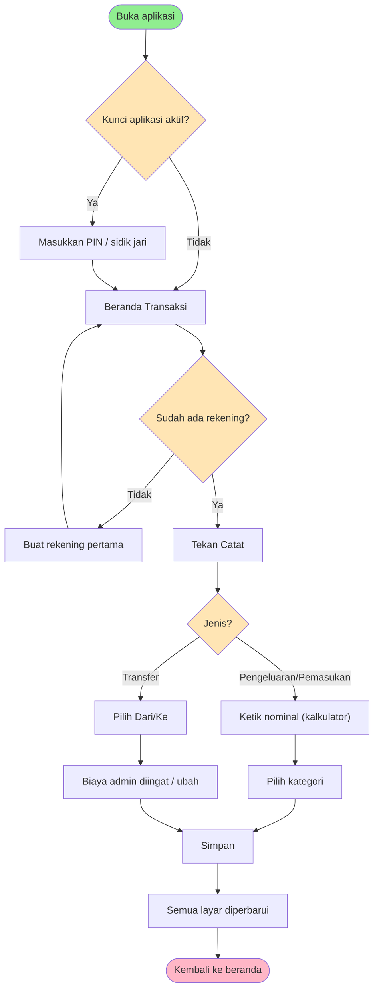
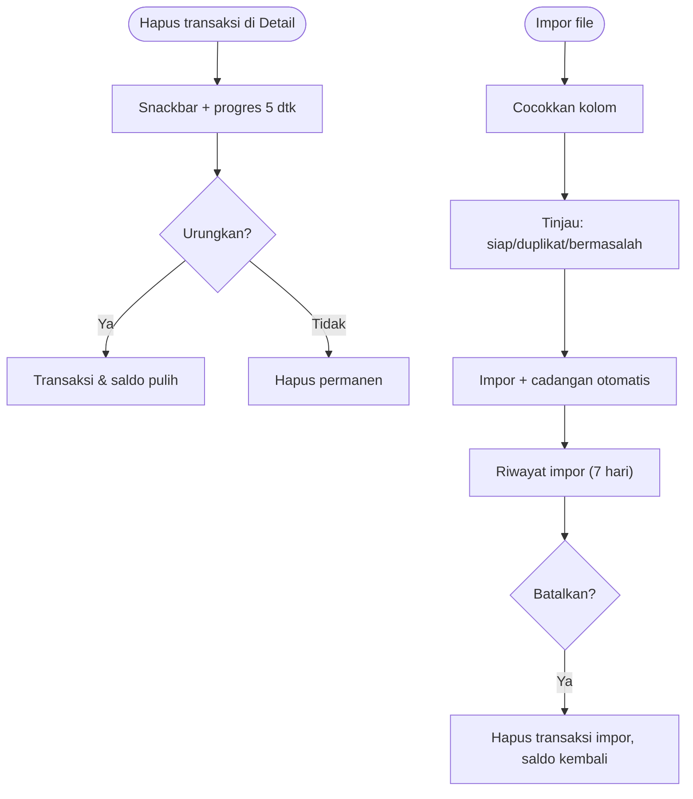

# Feature Specification: Kobalt Redesign — Tampilan, Flow & Komponen

**Feature Branch**: `002-kobalt-redesign` (spec-only, no branch created)
**Created**: 2026-10-29
**Status**: Draft
**Input**: User description: "Saya ingin merombak tampilan dan flow serta setiap komponennya agar seperti gambar-gambar terlampir baik dari cara bertransaksi hingga color palete dan komponennya berdasarkan seluruh informasi gambar yang terlampir. Saya juga menyertakan .html jika anda membutuhkannya"
**Design source**: [inputs/01-komponen-ikon.png](inputs/01-komponen-ikon.png), [inputs/02-cadangan-impor.png](inputs/02-cadangan-impor.png), [inputs/03-kategori-laporan-pengaturan.png](inputs/03-kategori-laporan-pengaturan.png), [inputs/04-transaksi-terang-gelap.png](inputs/04-transaksi-terang-gelap.png); token & component digest: [inputs/kobalt-design-digest.md](inputs/kobalt-design-digest.md)

Context: builds on `001-ui-polish-revamp` (calm slate palette, shared feedback helpers, DB consistency).
Many flows already exist in the app (calculator keypad, transfer with admin fee, PIN lock, Google
Drive backup, CSV export/import, budgets, recurring, search, calendar). This feature re-skins every
screen to the "Kobalt" design board **and** changes the flows where the board differs.

## User Scenarios & Testing *(mandatory)*

### User Story 1 - Fondasi visual Kobalt & navigasi baru (Priority: P1)

Pengguna membuka aplikasi dan semua layar memakai bahasa visual Kobalt: font Plus Jakarta Sans
dengan angka tabular, latar gelap berlapis (latar/kartu/permukaan), aksen biru kobalt, kartu kaca
dengan satu orb cahaya di pojok kanan atas, serta komponen yang sama di semua layar (tombol, chip,
segmen, kolom isian, saklar, baris daftar, snackbar, toast, dialog, papan angka). Navigasi bawah
berisi empat tujuan — **Transaksi · Laporan · Rekening · Pengaturan** — dengan tombol **Catat**
bulat di tengah yang menonjol ke atas.

**Why this priority**: Fondasi yang dipakai semua cerita lain; tanpa token & komponen bersama,
setiap layar akan dibangun ulang dengan gaya berbeda.

**Independent Test**: Buka setiap tab dan layar turunan; semua warna, radius, tipografi, dan
komponen cocok dengan papan komponen (board 01). Navigasi bawah menampilkan 4 tab + Catat.

**Acceptance Scenarios**:

1. **Given** aplikasi dibuka, **When** pengguna melihat tab mana pun, **Then** latar #111318, kartu #181B21, aksen #5B8CFF, dan teks #E7E9EE dipakai, dan angka nominal sejajar (tabular) dengan tanda minus "−".
2. **Given** navigasi bawah, **When** pengguna menyentuh tab, **Then** tab aktif tampil dengan teks aksen dan pil aksen lembut di belakang ikon; tombol Catat selalu terlihat di tengah.
3. **Given** layar dengan kartu ringkasan, **When** ditampilkan, **Then** kartu memakai efek kaca dan hanya ada satu orb ambient per layar.
4. **Given** pengguna mengaktifkan "Kurangi transparansi", **When** kembali ke layar mana pun, **Then** semua efek kaca diganti warna padat yang setara.

---

### User Story 2 - Catat transaksi dengan papan angka kalkulator (Priority: P1)

Dari tombol Catat, pengguna membuka layar "Catat transaksi" dengan segmen
**Pengeluaran · Pemasukan · Transfer**, nominal besar di tengah, grid kategori "paling sering"
(2 baris × 5, kategori terpilih diberi cincin aksen, tautan "Lihat semua"), lalu lembar bawah kaca
berisi pemilih rekening, pemilih tanggal ("Hari ini"), kolom catatan, dan papan angka 5×4
(7-8-9 ÷ ⌫ / 4-5-6 × / 1-2-3 − / C-0-000 + dengan tombol **Simpan** tinggi di kolom kanan).
Saat menghitung, ekspresi tampil kecil di atas hasil (mis. "45.000 + 12.500" → Rp 57.500).

**Why this priority**: Mencatat adalah aksi terpenting aplikasi; desain mengubah cara bertransaksi.

**Independent Test**: Catat pengeluaran 45.000 + 12.500 kategori Makanan rekening BCA; transaksi
Rp 57.500 tersimpan, saldo BCA berkurang, dan beranda langsung memperlihatkannya.

**Acceptance Scenarios**:

1. **Given** layar Catat, **When** pengguna mengetik 45.000, +, 12.500, **Then** ekspresi tampil di atas dan hasil Rp 57.500 tampil besar.
2. **Given** hasil ≤ 0 (mis. 45.000 − 50.000), **When** dihitung, **Then** hasil tampil merah "−5.000", pesan "Hasil harus lebih dari 0" muncul, dan Simpan nonaktif (opasitas 40 %).
3. **Given** segmen Transfer dipilih, **When** disentuh, **Then** pengguna berpindah ke alur transfer (US3) tanpa kehilangan nominal yang sudah diketik.
4. **Given** kategori belum ada di 10 teratas, **When** pengguna menyentuh "Lihat semua", **Then** semua kategori jenis itu bisa dipilih.
5. **Given** transaksi tersimpan, **When** kembali ke beranda, **Then** semua tampilan (beranda, laporan, rekening, anggaran) sudah memperbarui angkanya.

---

### User Story 3 - Transfer dengan biaya admin yang diingat (Priority: P1)

Layar Transfer menampilkan kartu **Dari / Ke** (nama rekening + saldo) dengan tombol tukar bulat,
kolom "Jumlah transfer", bagian **Biaya admin** berisi chip **Tidak ada · nilai terakhir (ikon
riwayat) · nilai umum lain · Isi sendiri**, pilihan **Dipotong dari: Saldo <asal> / Uang diterima**,
dan baris ringkasan, mis. "BCA −Rp 102.500 → GoPay +Rp 100.000 — Biaya Rp 2.500 ditambahkan ke
potongan BCA dan dicatat sebagai pengeluaran Biaya admin."

**Why this priority**: Transfer antar rekening dengan biaya admin adalah kebutuhan harian di
Indonesia; desain menetapkan alur yang lebih cepat (biaya diingat per pasangan rekening).

**Independent Test**: Transfer BCA→GoPay Rp 100.000 dengan admin 2.500 dipotong dari saldo BCA;
saldo BCA −102.500, GoPay +100.000, dan ada pengeluaran Biaya admin 2.500. Transfer berikutnya
BCA→GoPay langsung memilih 2.500.

**Acceptance Scenarios**:

1. **Given** pasangan BCA→GoPay pernah memakai admin 2.500, **When** pengguna membuka transfer dengan pasangan itu, **Then** chip 2.500 (dengan ikon riwayat) terpilih otomatis.
2. **Given** "Dipotong dari: Uang diterima" dan admin 4.000, **When** jumlah 100.000, **Then** ringkasan "BCA −Rp 100.000 → GoPay +Rp 96.000" dan selisih dicatat sebagai pengeluaran Biaya admin.
3. **Given** "Tidak ada", **When** disimpan, **Then** saldo berpindah utuh dan ringkasan "Tanpa biaya. Saldo berpindah utuh."
4. **Given** "Isi sendiri", **When** dipilih, **Then** chip berubah menjadi kolom nominal aktif dan papan angka mengisi biaya, bukan jumlah transfer.
5. **Given** jumlah + biaya melebihi saldo asal, **When** diketik, **Then** kolom jumlah bergaris kuning dan pesan peringatan "Saldo BCA kurang Rp 582.500. Tetap bisa disimpan, saldo jadi minus." — penyimpanan tetap diizinkan.
6. **Given** tombol tukar, **When** disentuh, **Then** rekening asal dan tujuan bertukar dan biaya yang diingat untuk pasangan baru dipakai.

---

### User Story 4 - Beranda Transaksi, detail, privasi & urungkan (Priority: P2)

Beranda "Transaksi" berisi: header (judul, Cari, Kalender, mata privasi); kartu kaca ringkasan
(sapaan sesuai waktu, navigasi periode ‹ Oktober 2026 ›, "Sisa periode ini", Pemasukan/Pengeluaran,
satu baris insight mingguan); kartu Anggaran bulan ini (persen, progres, peringatan kategori
mendekati batas); chip filter Semua/Pengeluaran/Pemasukan/Transfer; daftar dikelompokkan per hari
dengan total harian. Detail transaksi menampilkan ikon besar, nama, nominal besar, jenis, rincian
(Kategori, Rekening, Tanggal, Catatan), anggaran kategori terkait, aksi "Jadikan transaksi
berulang" & "Duplikat ke hari ini", dan "Hapus transaksi" (bisa diurungkan 5 detik). Mode privasi
mengganti semua nominal dengan "Rp ••••••".

**Why this priority**: Layar yang paling sering dilihat; bergantung pada fondasi US1.

**Independent Test**: Buka beranda, ubah filter dan periode, buka detail, hapus, urungkan dalam
5 detik — transaksi kembali beserta saldonya; aktifkan privasi — nominal tersembunyi di semua tab.

**Acceptance Scenarios**:

1. **Given** transaksi dihapus, **When** snackbar "… dihapus" dengan "Urungkan" dan bilah progres 5 detik muncul, **Then** menyentuh Urungkan memulihkan transaksi dan saldo; setelah 5 detik penghapusan permanen.
2. **Given** mode privasi aktif, **When** berpindah ke Laporan atau Rekening, **Then** nominal juga tersembunyi (persentase tetap tampil) dan ikon mata tampil aktif.
3. **Given** "Sembunyikan saldo saat dibuka" aktif di Pengaturan, **When** aplikasi dibuka, **Then** mode privasi sudah aktif.
4. **Given** pengguna baru tanpa rekening, **When** membuka beranda, **Then** tampil kartu sambutan "Mulai dengan satu rekening" dengan formulir nama, jenis (Tunai/Bank/E-wallet/Lainnya), saldo awal, dan tombol "Buat rekening"; tombol Catat meminta membuat rekening dulu.

---

### User Story 5 - Laporan, Rekening, Anggaran, Cari & Kalender (Priority: P2)

- **Laporan**: segmen Minggu/Bulan/Tahun, navigasi periode, kartu kaca total (pengeluaran ↔
  pemasukan via chip), perbandingan dengan periode sebelumnya, grafik batang tren (6 bulan /
  7 hari / 12 bulan; periode berjalan disorot aksen, hari/bulan mendatang garis putus-putus),
  donat per kategori (5 teratas + Lainnya) dengan legenda persen, dan rincian kategori dengan
  bilah relatif & jumlah transaksi. Dalam mode privasi tampil catatan "Nominal disembunyikan…".
- **Rekening**: kartu kaca Kekayaan bersih (Aset, Liabilitas), grup yang bisa dilipat
  (Kas & bank, E-wallet, Investasi, Kartu kredit) dengan subtotal, tombol tambah, tautan
  "N rekening diarsipkan". Hapus rekening yang punya transaksi memunculkan dialog yang
  menyarankan **Arsipkan** sebagai pilihan utama, **Hapus beserta N transaksi** sebagai pilihan bahaya, lalu Batal.
- **Anggaran**: kartu kaca sisa anggaran bulan ini + "Aman dibelanjakan ± Rp X per hari",
  kelompok **Perlu perhatian** (lewat batas = merah, ≥ 80 % = kuning) dan **Aman**. Kosong:
  ajakan "Buat anggaran" + saran dari rata-rata 3 bulan (tombol "Pakai") bila riwayat ≥ 1 bulan.
- **Cari**: kolom cari fokus, chip filter periode/jenis/rekening, jumlah hasil & total, hasil
  dikelompokkan per hari dengan kata kunci disorot; sebelum mengetik tampil pencarian terakhir
  dan "Cari per kategori"; nihil tampil saran ejaan dan "Cari di semua periode".
- **Kalender**: kartu kaca ringkasan bulan, grid tanggal dengan titik (abu = pengeluaran,
  hijau = pemasukan), tombol "Hari ini", daftar transaksi tanggal terpilih.

**Why this priority**: Fitur analisis yang sudah ada; perlu tampilan & alur baru setelah P1.

**Independent Test**: Setiap layar dapat dibuka dari navigasi atau beranda dan menampilkan data
yang sama dengan beranda untuk periode yang sama.

**Acceptance Scenarios**:

1. **Given** Laporan tab Tahun, **When** dibuka, **Then** 12 batang tampil dengan bulan berjalan disorot dan bulan mendatang putus-putus.
2. **Given** kategori Hiburan lewat batas Rp 80.000, **When** Anggaran dibuka, **Then** Hiburan ada di "Perlu perhatian" dengan teks merah "Lewat Rp 80.000".
3. **Given** rekening Mandiri dengan 42 transaksi, **When** pengguna memilih hapus, **Then** dialog menawarkan Arsipkan, Hapus beserta 42 transaksi, dan Batal.
4. **Given** pencarian "kopiii" tidak ada hasil, **When** ditampilkan, **Then** muncul saran "Mungkin maksudnya “kopi”?" dan tombol "Cari di semua periode".

---

### User Story 6 - Kelola kategori dengan 107 ikon & 12 warna (Priority: P2)

Layar Kategori: segmen Pengeluaran · N / Pemasukan · N, tombol tonal "Tambah kategori", petunjuk
urutan, daftar dengan pegangan geser (⠿), ikon berwarna, nama, "N transaksi · anggaran Rp X",
dan tautan "N kategori diarsipkan". Layar Kategori baru: kartu pratinjau langsung, nama (maks
30 huruf), jenis, 12 lingkaran warna (terpilih bercincin + centang), ikon per kelompok (chip
kelompok + grid 6 kolom, tautan "Cari dari 107 ikon"), dan tombol bawah "Simpan kategori".

**Why this priority**: Kategori menentukan tampilan setiap baris transaksi.

**Independent Test**: Buat kategori "Langganan streaming" warna Lavender ikon Langganan; kategori
muncul di Catat dan di daftar dengan ikon & warna yang sama.

**Acceptance Scenarios**:

1. **Given** layar Kategori baru, **When** warna atau ikon diganti, **Then** kartu pratinjau langsung berubah.
2. **Given** daftar kategori, **When** pengguna menahan & menggeser pegangan, **Then** urutan tersimpan; layar Catat tetap menaruh yang paling sering dipakai di baris pertama.
3. **Given** "Cari dari 107 ikon", **When** mengetik "kopi", **Then** ikon Kopi ditemukan.

---

### User Story 7 - Pengaturan, tampilan, ukuran teks & kunci PIN (Priority: P3)

Pengaturan berisi kartu kaca "Data tersimpan di HP ini" (status cadangan terakhir + "Cadangkan
sekarang"), lalu grup **Keuangan** (Rekening, Kategori, Anggaran, Transaksi berulang — masing-masing
dengan hitungan), **Tampilan** (Tema, Ukuran teks, Kurangi transparansi, Awal bulan, Mata uang),
**Keamanan & data** (Kunci aplikasi, Sembunyikan saldo saat dibuka, Cadangan Google Drive,
Ekspor & impor Excel), **Lainnya** (Getaran, Tentang Artavia), dan "Reset seluruh data" merah.
Ukuran teks: saklar "Ikuti ukuran teks sistem", penggeser 90/100/115/130/150 %, pratinjau, dan
"Kembalikan ke 100 %". Layar PIN: ikon gembok, "Masukkan PIN", 6 titik, papan bulat 3×4 dengan
sidik jari dan hapus, pesan "PIN salah. Sisa N percobaan.", tautan "Lupa PIN?" yang menjelaskan
pemulihan lewat cadangan Drive.

**Why this priority**: Pelengkap; sebagian besar pengaturan sudah ada dan hanya perlu ditata ulang.

**Independent Test**: Ubah ukuran teks ke 130 % — teks di beranda membesar, judul panjang turun
baris, nominal tetap utuh. Salah PIN — titik merah dan sisa percobaan berkurang.

**Acceptance Scenarios**:

1. **Given** ukuran teks 130 %, **When** baris transaksi berjudul panjang, **Then** judul turun ke baris berikutnya dan nominal tetap utuh di kanan.
2. **Given** PIN salah, **When** dimasukkan, **Then** titik berubah merah dan pesan menampilkan sisa percobaan.
3. **Given** Getaran aktif, **When** menekan papan angka atau menyimpan, **Then** perangkat bergetar ringan.
4. **Given** pengguna memilih tema, **When** Tema diubah, **Then** pilihan Gelap, Terang, atau Ikuti sistem langsung diterapkan ke semua layar dengan token warna versi masing-masing.

---

### User Story 8 - Cadangan Google Drive & pulihkan di HP baru (Priority: P3)

Layar Cadangan Google Drive punya tiga keadaan: **belum terhubung** (penjelasan manfaat, catatan
akses folder khusus, "Hubungkan Google Drive" / "Nanti saja"), **terhubung** (akun + Ganti, status
cadangan terakhir, Pengaturan: Cadangan otomatis harian, Hanya lewat Wi-Fi, Kunci dengan kata
sandi; Riwayat 5 cadangan terakhir dengan "Pulihkan"; "Putuskan Google Drive"), dan **sedang
mencadangkan** (progres persen + "Batalkan"). Di HP baru, layar "Cadangan ditemukan" menampilkan
asal, tanggal, isi, ukuran, "Pilih cadangan lain (5)", kolom kata sandi, "Pulihkan data" dan
"Mulai dari awal". Cadangan gagal saat offline memunculkan toast dengan "Coba lagi".

**Why this priority**: Fungsi cadangan sudah ada; ini perluasan alur dan keamanan.

**Independent Test**: Hubungkan Drive, cadangkan, pasang ulang aplikasi, pulihkan dengan kata
sandi — semua transaksi kembali.

**Acceptance Scenarios**:

1. **Given** kata sandi salah, **When** "Pulihkan data", **Then** kolom bergaris merah dan pesan menampilkan petunjuk sandi yang dibuat pengguna.
2. **Given** offline, **When** cadangan otomatis/manual gagal, **Then** toast "Cadangan gagal … Data tetap aman di HP ini" dengan "Tutup" dan "Coba lagi".

---

### User Story 9 - Ekspor & impor Excel/CSV dengan riwayat impor (Priority: P3)

Ekspor: segmen Ekspor/Impor, pilihan format Excel (.xlsx, satu lembar per jenis data) atau CSV
(hanya transaksi), periode (Bulan ini/Tahun ini/Semua/Pilih…), isi file (Transaksi, Rekening &
saldo, Kategori, Anggaran dengan hitungan), pratinjau tabel, tombol "Ekspor N transaksi".
Impor 3 langkah: (1) Pilih file dari HP/Drive, info yang bisa diimpor, unduh template;
(2) Cocokkan kolom (Tanggal & Jumlah wajib, Jenis, Kategori, Rekening, Catatan, Biaya admin),
deteksi format tanggal & pemisah ribuan; (3) Tinjau: angka ringkas siap/duplikat/bermasalah, daftar
baris bermasalah (+ unduh daftar), kategori/rekening baru dengan pilihan "Buat baru" / "Gabung: X",
lalu "Impor N transaksi". Riwayat impor: impor bisa dibatalkan selama 7 hari, dengan dialog
konfirmasi yang memperingatkan transaksi yang sudah diubah setelah impor.

**Why this priority**: Fitur lanjutan; ekspor/impor CSV dasar sudah ada.

**Independent Test**: Ekspor ke Excel, impor file itu kembali ke data kosong tanpa mengubah apa
pun — jumlah transaksi & saldo sama. Batalkan impor — transaksi impor terhapus dan saldo kembali.

**Acceptance Scenarios**:

1. **Given** file berisi 12 baris yang sama persis dengan data yang ada, **When** ditinjau, **Then** 12 terhitung duplikat dan dilewati.
2. **Given** baris dengan tanggal 31/02/2025, **When** ditinjau, **Then** baris masuk daftar bermasalah dan tidak diimpor.
3. **Given** impor kurang dari 7 hari lalu, **When** dibatalkan, **Then** semua transaksi impor terhapus dan saldo rekening kembali; pilihan "Batalkan, simpan N yang diubah" mempertahankan transaksi yang diubah setelah impor.

---

### Edge Cases

- Nominal hasil kalkulator > 0 tetapi dibagi menghasilkan pecahan → dibulatkan ke rupiah terdekat.
- Ekspresi berakhir dengan operator saat Simpan ditekan → operator diabaikan, nilai terakhir dipakai.
- Nominal sangat besar (≥ Rp 1 miliar) → angka mengecil otomatis sebelum disingkat (mis. "Rp 1,2 M"), tidak terpotong.
- Transfer ke rekening yang sama sebagai asal & tujuan → tidak diizinkan, pemilih tujuan menyembunyikan rekening asal.
- Biaya admin ≥ jumlah transfer saat "Uang diterima" → error "Biaya harus lebih kecil dari jumlah transfer", Simpan nonaktif.
- Urungkan hapus lalu aplikasi ditutup sebelum 5 detik → penghapusan tetap berlaku (tidak ada data menggantung).
- Kategori/rekening diarsipkan → tidak muncul di pemilih, tetapi transaksi lama tetap tampil dengan ikon & warnanya.
- Ukuran teks 150 % pada layar 360 dp → tidak ada teks terpotong pada tombol atau nominal; tata letak berpindah ke baris berikutnya.
- Mode privasi saat membuat tangkapan pratinjau aplikasi terbaru → nominal tetap tersembunyi.
- Impor file dengan kolom wajib tidak terpetakan → "Lanjut tinjau" nonaktif dengan pesan kolom yang kurang.
- Cadangan dimulai lalu jaringan putus → status kembali ke cadangan terakhir yang sukses + toast gagal.

## Requirements *(mandatory)*

### Functional Requirements

**Fondasi & komponen (US1)**
- **FR-001**: Aplikasi MUST memakai token warna, tipografi (Plus Jakarta Sans, angka tabular, minus U+2212), radius, jarak, dan lapisan kaca sesuai [kobalt-design-digest](inputs/kobalt-design-digest.md); tidak ada warna di luar token.
- **FR-002**: Aplikasi MUST menyediakan satu set komponen bersama: tombol (utama, tonal, teks, bahaya, nonaktif), chip, segmen, kolom isian (biasa/aktif/error/peringatan), saklar, centang, radio, bilah kemajuan, baris daftar, kartu kaca, angka ringkas, navigasi bawah, snackbar dengan urungkan, toast, dialog, dan papan angka — dipakai ulang di semua layar.
- **FR-003**: Navigasi bawah MUST berisi Transaksi, Laporan, [Catat], Rekening, Pengaturan; Laporan menggabungkan tampilan grafik dan laporan lama menjadi satu layar.
- **FR-004**: Setiap layar utama MUST menampilkan tepat satu orb ambient; pengaturan "Kurangi transparansi" MUST mengganti semua kaca & orb dengan warna padat.
- **FR-005**: Semua target sentuh MUST ≥ 44 px dan teks MUST ≥ 12 px pada skala 100 %.

**Catat & transfer (US2, US3)**
- **FR-006**: Layar Catat MUST menyatukan Pengeluaran/Pemasukan/Transfer dalam satu segmen; berpindah segmen mempertahankan nominal yang sudah diketik.
- **FR-007**: Papan angka MUST mendukung + − × ÷, hapus satu digit, hapus semua (C), dan "000"; ekspresi aktif tampil di atas hasil.
- **FR-008**: Simpan MUST nonaktif dan pesan error tampil bila hasil ≤ 0.
- **FR-009**: Grid kategori MUST menampilkan 10 kategori paling sering dipakai untuk jenis terpilih, plus "Lihat semua".
- **FR-010**: Pemilih rekening & tanggal default ke rekening terakhir dipakai dan "Hari ini".
- **FR-011**: Transfer MUST mengingat biaya admin terakhir per pasangan rekening (asal→tujuan) dan memilihnya otomatis.
- **FR-012**: Transfer MUST mendukung biaya dipotong dari saldo asal atau dari uang yang diterima, dan mencatat biaya > 0 sebagai pengeluaran kategori "Biaya admin".
- **FR-013**: Transfer MUST menampilkan ringkasan perubahan saldo kedua rekening secara langsung, dan peringatan (bukan blokir) bila saldo asal tidak cukup.

**Beranda & detail (US4)**
- **FR-014**: Beranda MUST menampilkan ringkasan periode (sisa, pemasukan, pengeluaran), satu insight perbandingan minggu ini vs minggu lalu, kartu anggaran bulan ini, chip filter jenis, dan daftar per hari dengan total harian.
- **FR-015**: Penghapusan transaksi MUST bisa diurungkan selama 5 detik lewat snackbar dengan bilah progres; urungkan memulihkan transaksi dan saldo.
- **FR-016**: Mode privasi MUST berlaku global (Transaksi, Laporan, Rekening, Anggaran, Detail) dan bisa diaktifkan otomatis saat aplikasi dibuka.
- **FR-017**: Detail transaksi MUST menyediakan "Ubah", "Jadikan transaksi berulang", "Duplikat ke hari ini", dan "Hapus transaksi".
- **FR-018**: Pengguna tanpa rekening MUST melihat formulir rekening pertama di beranda; Catat tidak bisa dibuka sebelum ada rekening.

**Laporan, rekening, anggaran, cari, kalender (US5)**
- **FR-019**: Laporan MUST mendukung rentang Minggu/Bulan/Tahun, pengeluaran ↔ pemasukan, perbandingan dengan periode sebelumnya, grafik tren, donat 5 kategori teratas + Lainnya, dan rincian kategori.
- **FR-020**: Rekening MUST dikelompokkan per jenis dengan subtotal yang bisa dilipat, menampilkan kekayaan bersih = aset − liabilitas, dan mendukung arsip.
- **FR-021**: Menghapus rekening atau kategori yang memiliki transaksi MUST menawarkan Arsipkan sebagai pilihan utama.
- **FR-022**: Anggaran MUST mengelompokkan kategori ke "Perlu perhatian" (≥ 80 % atau lewat batas) dan "Aman", serta menghitung batas aman harian; layar kosong menyarankan anggaran dari rata-rata 3 bulan bila data ≥ 1 bulan.
- **FR-023**: Cari MUST mencocokkan nama, catatan, kategori, dan rekening; menyimpan pencarian terakhir; menyorot kata kunci; dan menawarkan saran ejaan serta "Cari di semua periode" saat nihil.
- **FR-024**: Kalender MUST menandai hari dengan pengeluaran dan/atau pemasukan dan menampilkan transaksi tanggal terpilih.

**Kategori (US6)**
- **FR-025**: Pengguna MUST bisa memilih 1 dari 12 warna dan 1 dari 107 ikon (13 kelompok, dapat dicari) untuk kategori, dengan pratinjau langsung.
- **FR-026**: Urutan kategori MUST bisa diubah dengan seret, dan kategori MUST bisa diarsipkan/dipulihkan.

**Pengaturan & keamanan (US7)**
- **FR-027**: Pengaturan MUST ditata ulang ke grup Keuangan, Tampilan, Keamanan & data, Lainnya, dengan kartu status data di atas.
- **FR-028**: Ukuran teks MUST bisa mengikuti sistem atau dipilih manual 90/100/115/130/150 % dengan pratinjau.
- **FR-029**: Layar PIN MUST menampilkan sisa percobaan saat salah, mendukung sidik jari, dan menjelaskan pemulihan lewat cadangan saat lupa PIN.
- **FR-030**: Getaran MUST bisa diaktifkan untuk tekan tombol & simpan.
- **FR-031**: Tema MUST mendukung Gelap, Terang, dan Ikuti sistem (default), memakai token warna gelap/terang dari papan desain untuk setiap layar.

**Cadangan (US8)**
- **FR-032**: Layar Google Drive MUST menampilkan keadaan belum terhubung, terhubung, dan sedang mencadangkan, dengan cadangan otomatis harian, opsi hanya Wi-Fi, dan riwayat 5 cadangan terakhir yang bisa dipulihkan.
- **FR-033**: Cadangan MUST bisa dikunci dengan kata sandi opsional + petunjuk sandi; isi dienkripsi di HP sebelum diunggah. Saat aplikasi dipasang di HP baru dan masuk ke akun Google yang sama, layar "Cadangan ditemukan" menawarkan pemulihan (dengan kata sandi bila terkunci) atau mulai dari awal tanpa menghapus cadangan.

**Ekspor & impor (US9)**
- **FR-034**: Ekspor/impor MUST mendukung Excel (.xlsx, satu lembar per jenis data) dan CSV (transaksi saja); impor 3 langkah (pilih file, cocokkan kolom, tinjau) dengan cadangan otomatis sebelum impor; dan Riwayat impor yang bisa membatalkan impor selama 7 hari (opsi mempertahankan transaksi yang diubah setelah impor).
- **FR-035**: Impor MUST mendeteksi duplikat, melewati baris bermasalah dengan alasan, dan tidak menimpa data yang ada; pengguna melihat ringkasan sebelum apa pun disimpan.

### Non-Functional Requirements

- **NFR-001**: Semua teks utama MUST memiliki kontras ≥ 4.5:1 terhadap latarnya (teks redup ≥ 4.5:1 pada kartu).
- **NFR-002**: Membuka layar Catat dari tombol Catat dan menyimpan transaksi sederhana MUST bisa dilakukan dalam ≤ 3 sentuhan setelah mengetik nominal (kategori, Simpan).
- **NFR-003**: Pergantian tab dan pembaruan angka setelah simpan MUST terasa instan (< 300 ms pada data 5.000 transaksi).
- **NFR-004**: Efek kaca MUST tidak menurunkan kelancaran gulir di bawah 55 fps pada perangkat kelas menengah; bila tidak memungkinkan, otomatis memakai warna padat.
- **NFR-005**: Semua data tetap lokal; tidak ada panggilan jaringan selain alur Google Drive yang dimulai pengguna (constitution Principle I).
- **NFR-006**: Seluruh teks antarmuka dalam Bahasa Indonesia yang konsisten dengan papan desain.
- **NFR-007**: Elemen interaktif MUST memiliki label aksesibilitas (pembaca layar) yang setara dengan `aria-label` di desain.

### Key Entities

- **Transaksi**: catatan uang masuk/keluar/pindah.
  - Key attributes: jenis (pengeluaran/pemasukan/transfer), nominal, kategori, rekening, rekening tujuan (transfer), tanggal & jam, catatan, biaya admin, penanggung biaya (saldo asal / uang diterima), asal impor (opsional).
  - State lifecycle: aktif → dihapus-sementara (5 detik, bisa diurungkan) → dihapus permanen.
  - Relationships: milik satu Rekening (dan satu Rekening tujuan untuk transfer), satu Kategori, opsional satu Batch Impor.
- **Rekening**: tempat uang berada.
  - Key attributes: nama, jenis (Tunai/Bank/E-wallet/Investasi/Kartu kredit/Lainnya), saldo, warna, ikon, urutan, status arsip, info tambahan (jatuh tempo & limit kartu kredit).
  - State lifecycle: aktif ↔ diarsipkan; dihapus (hanya beserta transaksinya, dengan konfirmasi).
- **Kategori**: pengelompokan transaksi.
  - Key attributes: nama (≤ 30 huruf), jenis, warna (1 dari 12), ikon (1 dari 107), urutan, status arsip, jumlah pemakaian.
  - State lifecycle: aktif ↔ diarsipkan.
- **Preferensi Biaya Transfer**: biaya admin terakhir per pasangan rekening asal→tujuan dan penanggungnya.
- **Anggaran**: batas per kategori per bulan; status Aman / Mendekati (≥ 80 %) / Lewat.
- **Preferensi Tampilan**: tema, ukuran teks, kurangi transparansi, privasi saat dibuka, getaran, awal bulan, mata uang.
- **Cadangan**: salinan data di Drive; atribut: waktu, ukuran, jumlah transaksi, asal perangkat, terkunci sandi (ya/tidak), petunjuk sandi. Maks 5 disimpan.
- **Batch Impor**: atribut: nama file, waktu, jumlah transaksi, status (aktif / dibatalkan / kedaluwarsa setelah 7 hari).
- **Pencarian Terakhir**: daftar kata kunci terakhir (maks 5).

## Success Criteria *(mandatory)*

### Measurable Outcomes

- **SC-001**: 100 % layar yang ada di papan desain dapat ditemukan di aplikasi dan cocok secara visual (warna, tipografi, komponen) saat dibandingkan berdampingan.
- **SC-002**: Pengguna dapat mencatat pengeluaran (nominal + kategori + simpan) dalam ≤ 10 detik.
- **SC-003**: Transfer berulang ke pasangan rekening yang sama memerlukan 0 sentuhan tambahan untuk memilih biaya admin.
- **SC-004**: 100 % penghapusan transaksi dapat diurungkan dalam 5 detik tanpa selisih saldo.
- **SC-005**: Angka yang sama (sisa periode, kekayaan bersih, pemakaian anggaran) identik di semua layar yang menampilkannya.
- **SC-006**: Pada ukuran teks 150 %, tidak ada teks terpotong pada 12 layar utama.
- **SC-007**: Ekspor lalu impor ulang file yang sama tanpa perubahan menghasilkan 0 transaksi baru (semua terdeteksi duplikat).
- **SC-008**: Tidak ada warna hardcode di luar token (pemeriksaan otomatis lulus).

## UI/UX & Screens

### Design Reference

- **Design source**: papan PNG di `inputs/` (01 komponen & ikon, 02 cadangan & impor, 03 kategori/laporan/pengaturan, 04 transaksi gelap/terang) + HTML ekspor yang ditempel di sesi (diringkas ke `inputs/kobalt-design-digest.md`).
- **Look & feel / brand**: "Kobalt" — gelap, kalem, biru kobalt sebagai satu-satunya aksen, kaca + satu orb cahaya, angka tabular, Bahasa Indonesia santai ("kamu").
- **Existing UI to match**: menggantikan palet slate `001-ui-polish-revamp`; token latar/kartu/permukaan/teks sudah sama, aksen berubah #7AA2F7 → #5B8CFF.

### Screen Inventory

| Screen | Purpose | Serves story | Key data shown | Primary actions |
| ------ | ------- | ------------ | -------------- | --------------- |
| Transaksi (beranda) | Ringkasan & riwayat | US4 | sisa periode, pemasukan/pengeluaran, anggaran, transaksi per hari | cari, kalender, privasi, filter, buka detail |
| Pengguna baru | Rekening pertama | US4 | sambutan, formulir rekening | buat rekening |
| Catat transaksi | Mencatat | US2 | nominal/ekspresi, kategori, rekening, tanggal | hitung, pilih kategori, simpan |
| Transfer | Pindah saldo | US3 | dari/ke + saldo, jumlah, biaya admin, ringkasan | tukar, pilih biaya, simpan |
| Detail transaksi | Melihat & mengelola | US4 | rincian, anggaran kategori | ubah, berulang, duplikat, hapus |
| Cari | Menemukan transaksi | US5 | hasil per hari, total | filter, hapus pencarian |
| Kalender | Transaksi per tanggal | US5 | grid bulan, titik, daftar hari | pilih tanggal, hari ini |
| Laporan | Analisis | US5 | total, tren, donat, rincian kategori | ganti rentang/periode/jenis |
| Rekening | Saldo & kekayaan | US5 | kekayaan bersih, grup rekening | tambah, lipat grup, arsip/hapus |
| Anggaran | Batas belanja | US5 | sisa, per kategori | tambah, pakai saran |
| Pengaturan | Konfigurasi | US7 | status data, grup pengaturan | navigasi, saklar, reset |
| Kategori / Kategori baru | Kelola kategori | US6 | daftar, pratinjau, warna, ikon | urutkan, tambah, simpan |
| Ukuran teks | Aksesibilitas | US7 | penggeser, pratinjau | ubah, reset |
| Kunci PIN | Keamanan | US7 | titik PIN, status | masukkan PIN, sidik jari, lupa PIN |
| Cadangan Google Drive | Cadangan | US8 | akun, status, riwayat | hubungkan, cadangkan, pulihkan, putuskan |
| Cadangan ditemukan | Pulihkan di HP baru | US8 | info cadangan | pulihkan, mulai dari awal |
| Ekspor | Ekspor data | US9 | format, periode, isi, pratinjau | ekspor |
| Impor 1/2/3 | Impor data | US9 | file, pencocokan, ringkasan | pilih file, cocokkan, impor |
| Riwayat impor | Membatalkan impor | US9 | daftar impor | batalkan |

### Per-Screen Key States

- **Transaksi**: kosong (tanpa rekening) = kartu sambutan + formulir; kosong (tanpa transaksi) = "Belum ada transaksi"; privasi = nominal "Rp ••••••"; setelah hapus = snackbar urungkan.
- **Catat**: kosong = "Rp 0", Simpan nonaktif; menghitung = ekspresi + hasil; error = hasil merah + pesan, Simpan nonaktif.
- **Transfer**: biaya diingat, tanpa biaya, isi sendiri, saldo kurang (peringatan kuning).
- **Laporan**: periode tanpa data = grafik kosong + teks "Belum ada transaksi di periode ini"; privasi = nominal disembunyikan + catatan.
- **Cari**: belum mengetik = pencarian terakhir + kategori; ada hasil; nihil = saran.
- **Anggaran**: kosong (dengan/tanpa saran); berisi.
- **Rekening**: berisi; dialog hapus.
- **Pengaturan**: normal; cadangan gagal (toast).
- **PIN**: normal; salah (merah + sisa percobaan).
- **Drive**: belum terhubung; terhubung; proses; gagal.
- **Pulihkan**: normal; sandi salah.
- **Impor**: langkah 1/2/3; kolom wajib belum cocok (lanjut nonaktif).
- **Riwayat impor**: bisa dibatalkan; kedaluwarsa; dibatalkan; dialog konfirmasi.

### Primary Interactions & Flows

- Catat dibuka dari tombol tengah sebagai layar penuh dengan tombol tutup (×) bulat di kiri atas; Simpan menutup layar dan kembali ke tab asal.
- Segmen Transfer di Catat membawa ke alur transfer dalam layar yang sama.
- Kartu Anggaran di beranda membuka layar Anggaran; baris transaksi membuka Detail; ikon Ubah di Detail membuka Catat dalam mode ubah.
- Semua aksi merusak memakai dialog dengan pilihan aman sebagai tombol utama; hapus transaksi memakai urungkan, bukan dialog.
- Navigasi kembali memakai ikon chevron kiri; layar modal (Catat, Transfer, Kategori baru) memakai ikon ×.

## Business Process Flow

### Primary User Journey Flow

### Alternative/Secondary Flows

## Business Actors & Interactions

| Actor | Role | Key Interactions |
| ----- | ---- | ---------------- |
| Pengguna | Pemilik keuangan pribadi | Mencatat, transfer, melihat laporan, mengatur anggaran/kategori/rekening, cadangan, impor/ekspor |
| Sistem (aplikasi) | Penyimpan & penghitung lokal | Menjaga saldo konsisten, mengingat biaya transfer, menghitung ringkasan, menjalankan cadangan otomatis, mendeteksi duplikat |
| Google Drive | Penyimpanan cadangan opsional | Menyimpan/mengembalikan salinan data atas permintaan pengguna |

## Clarifications

### Session 2026-10-29

- Q: Tema apa yang didukung? → A: Gelap + Terang + Ikuti sistem (sesuai papan desain).
- Q: Cadangan Drive dengan kata sandi? → A: Ya — sandi opsional + petunjuk, enkripsi di HP, layar pulihkan di HP baru, riwayat 5 cadangan.
- Q: Cakupan Ekspor & Impor? → A: Penuh — Excel + CSV, impor 3 langkah, deteksi duplikat, riwayat impor batal 7 hari.

## Assumptions

- Semua ini adalah **rombak sisi aplikasi Flutter yang ada**; tidak ada server baru.
- Layar "Grafik" dan "Laporan" lama digabung menjadi satu tab **Laporan**; layar "Saya" menjadi tab **Pengaturan** (YAGNI — tidak ada duplikasi).
- Data contoh di papan desain (nama, nominal, email) hanya ilustrasi.
- Nilai biaya admin cepat selain nilai terakhir adalah 2.500 dan 6.500 (nilai umum antar-bank / e-wallet di Indonesia), bisa diubah nanti.
- Batas "mendekati batas" anggaran = 80 %.
- Ikon kategori lama dipetakan ke ikon baru terdekat saat pembaruan; tidak ada kategori yang hilang.
- Batch Impor dan Preferensi Biaya Transfer memerlukan penyimpanan baru (migrasi non-destruktif).
- Font Plus Jakarta Sans dibundel di aplikasi (berfungsi offline).

## Out of Scope

- Sinkronisasi antar perangkat secara real-time (hanya cadangan/pulihkan).
- Akun pengguna / login selain Google untuk Drive.
- Mata uang selain IDR (baris "Mata uang" hanya menampilkan IDR).
- Fitur baru yang tidak ada di papan desain.
